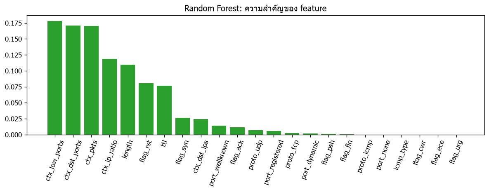
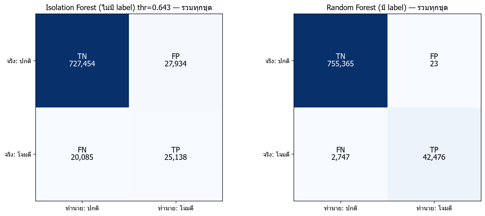
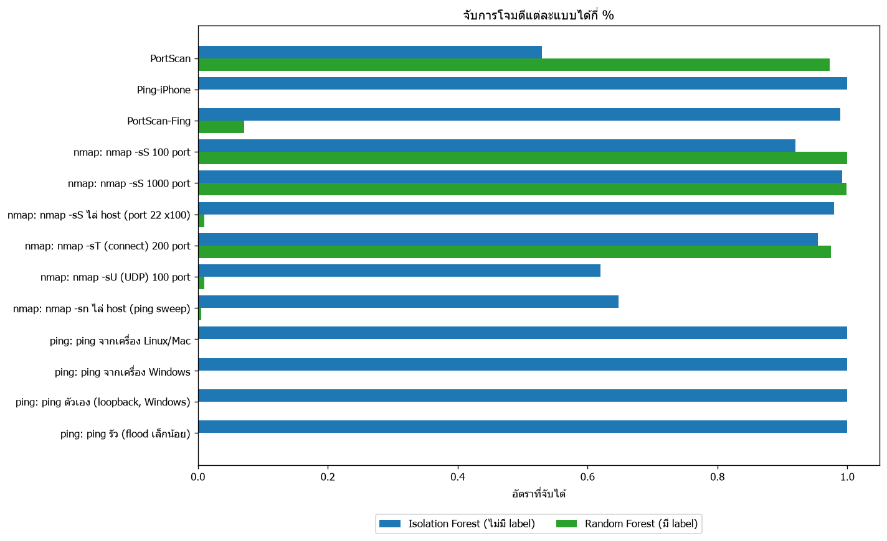

# เปรียบเทียบ Random Forest (มี label) vs Isolation Forest (ไม่มี label) — 2026-11-13 01:07:23

## ตั้งค่า

- FRIDAY_SPLIT = 2017-07-07T15:00:00-03:00
- RF: 100 trees, class_weight=balanced
- feature v2 (23 ตัว), window 5s
- กฎใน labels.csv: 3 ข้อ

## ข้อมูล

| ไฟล์ | ใช้ | packets | โจมตี |
|---|---|---|---|
| normal_packets.csv | เทรน RF (ปกติ) | 8000 | 0 |
| normal__Monday-WorkingHours.csv | เทรน RF (ปกติ) | 200000 | 0 |
| captured_packets.csv | เทรน RF (ปกติ) | 33160 | 0 |
| home_discord_normal.csv | เทรน RF (ปกติ) | 146497 | 0 |
| test__Friday-WorkingHours.csv | เทรน RF (ก่อน split) | 1052126 | 281787 |
| test__Friday-WorkingHours.csv | ทดสอบ (หลัง split) | 572373 | 42275 |
| home_test_session2.csv | ทดสอบ | 222254 | 964 |
| simulated | ทดสอบ | 5984 | 1984 |

ชุดเทรน RF: 1,439,783 packets (โจมตี 281,787)

label โจมตีที่ RF เห็นตอนเทรน: ['PortScan']

## โมเดล

- RF เทรน 68.0s
- Isolation Forest: เทรน 2026-11-12 22:09:40, threshold 0.6427

feature สำคัญสุด 5 อันดับของ RF: ctx_low_ports (0.178), ctx_dst_ports (0.171), ctx_pkts (0.171), ctx_ip_ratio (0.119), length (0.110)

## สรุปต่อชุดทดสอบ

| ชุดทดสอบ | โมเดล | Recall | FPR | Precision | F1 | FP | FN |
|---|---|---|---|---|---|---|---|
| CIC Friday (หลัง split) | Isolation Forest | 0.5300 | 0.0527 | 0.4453 | 0.4839 | 27916 | 19869 |
| CIC Friday (หลัง split) | Random Forest | 0.9724 | 0.0000 | 0.9994 | 0.9858 | 23 | 1165 |
| บ้าน: home_test_session2 | Isolation Forest | 0.9896 | 0.0000 | 1.0000 | 0.9948 | 0 | 10 |
| บ้าน: home_test_session2 | Random Forest | 0.0705 | 0.0000 | 1.0000 | 0.1318 | 0 | 896 |
| จำลอง (ping + nmap) | Isolation Forest | 0.8962 | 0.0045 | 0.9900 | 0.9407 | 18 | 206 |
| จำลอง (ping + nmap) | Random Forest | 0.6542 | 0.0000 | 1.0000 | 0.7910 | 0 | 686 |

## แยกตามประเภท

(normal = อัตรา alert หลอก ยิ่งต่ำยิ่งดี | การโจมตี = อัตราที่จับได้ ยิ่งสูงยิ่งดี)

| ชุดทดสอบ | label | packets | วัด | Isolation Forest | Random Forest |
|---|---|---|---|---|---|
| CIC Friday (หลัง split) | normal | 530098 | alert หลอก | 0.0527 | 0.0000 |
| CIC Friday (หลัง split) | PortScan | 42275 | จับได้ | 0.5300 | 0.9724 |
| บ้าน: home_test_session2 | normal | 221290 | alert หลอก | 0.0000 | 0.0000 |
| บ้าน: home_test_session2 | Ping-iPhone | 12 | จับได้ | 1.0000 | 0.0000 |
| บ้าน: home_test_session2 | PortScan-Fing | 952 | จับได้ | 0.9895 | 0.0714 |
| จำลอง (ping + nmap) | normal | 4000 | alert หลอก | 0.0045 | 0.0000 |
| จำลอง (ping + nmap) | nmap: nmap -sS 100 port | 100 | จับได้ | 0.9200 | 1.0000 |
| จำลอง (ping + nmap) | nmap: nmap -sS 1000 port | 1000 | จับได้ | 0.9920 | 0.9990 |
| จำลอง (ping + nmap) | nmap: nmap -sS ไล่ host (port 22 x100) | 100 | จับได้ | 0.9800 | 0.0100 |
| จำลอง (ping + nmap) | nmap: nmap -sT (connect) 200 port | 200 | จับได้ | 0.9550 | 0.9750 |
| จำลอง (ping + nmap) | nmap: nmap -sU (UDP) 100 port | 100 | จับได้ | 0.6200 | 0.0100 |
| จำลอง (ping + nmap) | nmap: nmap -sn ไล่ host (ping sweep) | 400 | จับได้ | 0.6475 | 0.0050 |
| จำลอง (ping + nmap) | ping: ping จากเครื่อง Linux/Mac | 8 | จับได้ | 1.0000 | 0.0000 |
| จำลอง (ping + nmap) | ping: ping จากเครื่อง Windows | 8 | จับได้ | 1.0000 | 0.0000 |
| จำลอง (ping + nmap) | ping: ping ตัวเอง (loopback, Windows) | 8 | จับได้ | 1.0000 | 0.0000 |
| จำลอง (ping + nmap) | ping: ping รัว (flood เล็กน้อย) | 60 | จับได้ | 1.0000 | 0.0000 |

## รวมทุกชุด (ระวัง: ตัวเลขนี้ถูกครอบงำด้วย CIC Friday ที่มี packet มากที่สุด ดูผลแยกชุดข้างบนประกอบ)

| โมเดล | Recall (TPR) | FPR | Precision | F1 | TP | FP | TN | FN |
|---|---|---|---|---|---|---|---|---|
| Isolation Forest | 0.5559 | 0.0370 | 0.4737 | 0.5115 | 25138 | 27934 | 727454 | 20085 |
| Random Forest | 0.9393 | 0.0000 | 0.9995 | 0.9684 | 42476 | 23 | 755365 | 2747 |

## กราฟ

