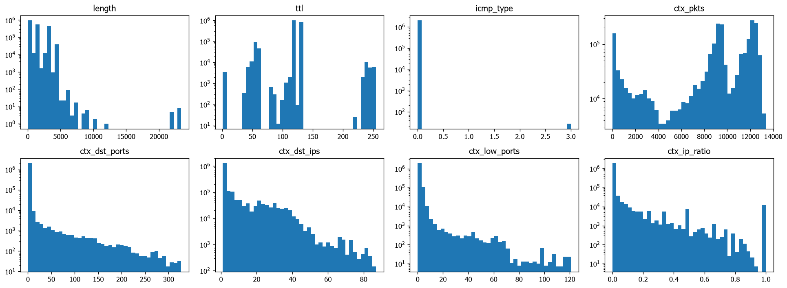
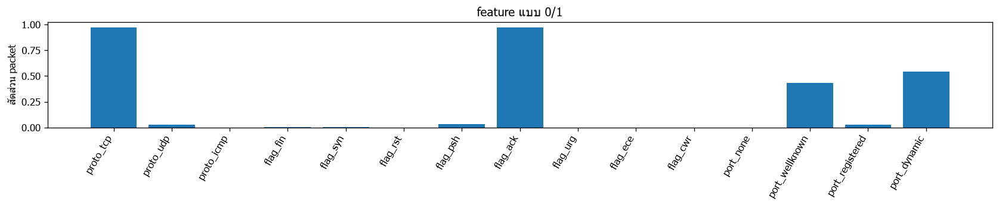
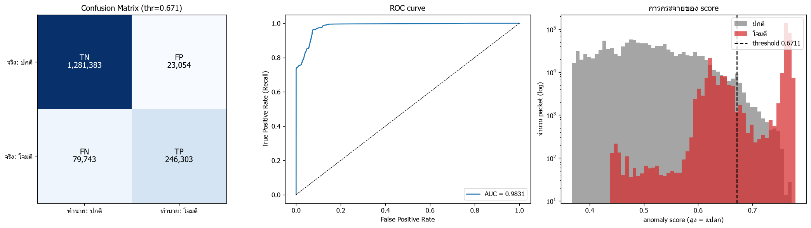

# ผลการเทรน 2026-11-12 19:28:51

## ตั้งค่า

| window_sec | n_estimators | seed | fp_quantile | max_packets/pcap | USE_SYNTHETIC | USE_CAPTURED | USE_SIM_TEST | DROP_ICMP_ECHO | THRESHOLD_MODE |
|---|---|---|---|---|---|---|---|---|---|
| 5 | 200 | 42 | 0.9980 | 2000000 | True | True | True | True | recommended |

time windows: `{'Friday-WorkingHours': ['2017-07-07T13:50:00-03:00', '2017-07-07T15:35:00-03:00']}`

## ข้อมูลเทรน (traffic ปกติ)

| ไฟล์ | packets | ตัด ping | TCP | UDP | ICMP | อื่นๆ |
|---|---|---|---|---|---|---|
| normal_packets.csv | 8000 | 0 | 6347 | 1626 | 27 | 0 |
| normal__Monday-WorkingHours.csv | 1999994 | 6 | 1949779 | 50140 | 0 | 75 |
| captured_packets.csv | 33160 | 0 | 30082 | 3043 | 0 | 35 |

รวม 2,041,154 packets x 23 features

## การกระจายของ feature

## เทรน

ใช้เวลา 58.2s | score ข้อมูลเทรน: median=0.350 p99=0.607 max=0.770

## ชุดทดสอบ

| ชุด | packets | ติด label โจมตี |
|---|---|---|
| จำลอง (ping + nmap) | 5984 | 1984 |
| test__Friday-WorkingHours.csv | 1624499 | 324062 |

รวม 1,630,483 packets | ปกติ 1,304,437 | โจมตี 326,046

กฎใน labels.csv: 1 ข้อ

## Threshold

- recommended = 0.6711 (คำเตือน: ping บางตัวมี score ต่ำกว่า quantile ของ traffic ปกติ — ใช้ค่า quantile ของ traffic ปกติ (ping อาจหลุดบางตัว) ลองเพิ่มข้อมูล/ปรับ fp_quantile)
- best_f1 = 0.6174
- **ใช้ 0.6711** (โหมด recommended)

| threshold | TP | FP | TN | FN | Accuracy | Precision | Recall (TPR) | F1 | FPR |
|---|---|---|---|---|---|---|---|---|---|
| 0.5500 | 324859 | 343355 | 961082 | 1187 | 0.7887 | 0.4862 | 0.9964 | 0.6535 | 0.2632 |
| 0.5700 | 324717 | 267829 | 1036608 | 1329 | 0.8349 | 0.5480 | 0.9959 | 0.7070 | 0.2053 |
| 0.5900 | 324317 | 192725 | 1111712 | 1729 | 0.8807 | 0.6273 | 0.9947 | 0.7694 | 0.1477 |
| 0.6100 | 315648 | 119827 | 1184610 | 10398 | 0.9201 | 0.7248 | 0.9681 | 0.8290 | 0.0919 |
| 0.6174 | 312536 | 96993 | 1207444 | 13510 | 0.9322 | 0.7632 | 0.9586 | 0.8498 | 0.0744 |
| 0.6300 | 278443 | 71595 | 1232842 | 47603 | 0.9269 | 0.7955 | 0.8540 | 0.8237 | 0.0549 |
| 0.6500 | 259718 | 44951 | 1259486 | 66328 | 0.9318 | 0.8525 | 0.7966 | 0.8236 | 0.0345 |
| 0.6700 | 246386 | 24298 | 1280139 | 79660 | 0.9362 | 0.9102 | 0.7557 | 0.8258 | 0.0186 |
| 0.6711 | 246303 | 23048 | 1281389 | 79743 | 0.9370 | 0.9144 | 0.7554 | 0.8274 | 0.0177 |
| 0.6900 | 242615 | 8900 | 1295537 | 83431 | 0.9434 | 0.9646 | 0.7441 | 0.8401 | 0.0068 |
| 0.7100 | 241447 | 4235 | 1300202 | 84599 | 0.9455 | 0.9828 | 0.7405 | 0.8446 | 0.0032 |
| 0.7300 | 240569 | 1595 | 1302842 | 85477 | 0.9466 | 0.9934 | 0.7378 | 0.8468 | 0.0012 |
| 0.7500 | 237766 | 286 | 1304151 | 88280 | 0.9457 | 0.9988 | 0.7292 | 0.8430 | 0.0002 |

## ผลการวัด

### Confusion Matrix (threshold = 0.6711)
| | ทำนาย: ปกติ | ทำนาย: โจมตี |
|---|---|---|
| **จริง: ปกติ** | TN = 1,281,383 | FP = 23,054 |
| **จริง: โจมตี** | FN = 79,743 | TP = 246,303 |

- **TP** จับการโจมตีได้ถูก · **FN** การโจมตีที่หลุด
- **FP** alert หลอก (ปกติแต่ถูกมองว่าแปลก) · **TN** ปกติและตอบว่าปกติ

### Metrics
| metric | ค่า |
|---|---|
| Accuracy | 0.9370 |
| Precision | 0.9144 |
| Recall (TPR) | 0.7554 |
| F1 | 0.8273 |
| FPR | 0.0177 |
| Specificity (TNR) | 0.9823 |
| Balanced Acc | 0.8689 |
| ROC-AUC | 0.9831 |

### แยกตาม label
(แถว normal = อัตรา alert หลอก, แถวโจมตี = อัตราที่จับได้)

| label | packets | ถูกมองว่าแปลก | อัตรา |
|---|---|---|---|
| normal | 1304437 | 23054 | 0.0177 |
| PortScan | 324062 | 244748 | 0.7553 |
| nmap: nmap -sS 100 port | 100 | 92 | 0.9200 |
| nmap: nmap -sS 1000 port | 1000 | 993 | 0.9930 |
| nmap: nmap -sS ไล่ host (port 22 x100) | 100 | 96 | 0.9600 |
| nmap: nmap -sT (connect) 200 port | 200 | 192 | 0.9600 |
| nmap: nmap -sU (UDP) 100 port | 100 | 44 | 0.4400 |
| nmap: nmap -sn ไล่ host (ping sweep) | 400 | 138 | 0.3450 |
| ping: ping จากเครื่อง Linux/Mac | 8 | 0 | 0.0000 |
| ping: ping จากเครื่อง Windows | 8 | 0 | 0.0000 |
| ping: ping ตัวเอง (loopback, Windows) | 8 | 0 | 0.0000 |
| ping: ping รัว (flood เล็กน้อย) | 60 | 0 | 0.0000 |

## กราฟ Confusion Matrix / ROC / score

## บันทึกโมเดล

- model_path: `C:\Project_AI\Project-AI-IDS\system\models\iforest.joblib`
- scaler_path: `C:\Project_AI\Project-AI-IDS\system\models\scaler.joblib`
- meta_path: `C:\Project_AI\Project-AI-IDS\system\models\meta.json`
- แหล่งข้อมูลเทรน: normal_packets.csv, normal__Monday-WorkingHours.csv, captured_packets.csv
