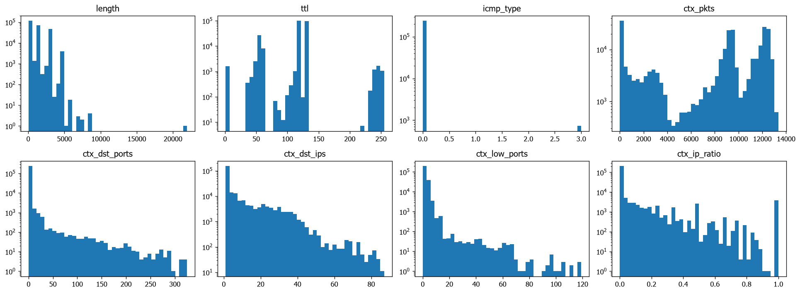
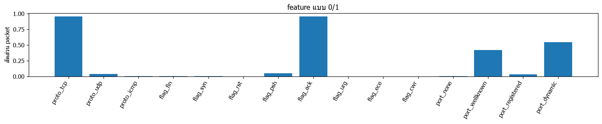
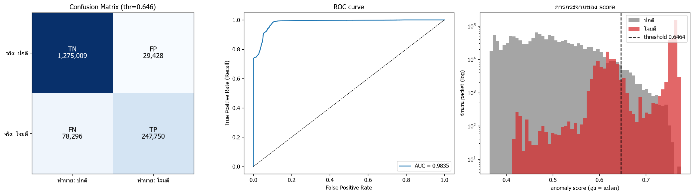

# ผลการเทรน 2026-11-12 20:52:14

## ตั้งค่า

| window_sec | n_estimators | seed | fp_quantile | max_packets/pcap | USE_SYNTHETIC | USE_CAPTURED | USE_SIM_TEST | DROP_ICMP_ECHO | THRESHOLD_MODE | MAX_TRAIN_PER_SOURCE | ICMP_MIN_FRAC |
|---|---|---|---|---|---|---|---|---|---|---|---|
| 5 | 200 | 42 | 0.9980 | 2000000 | True | True | True | True | recommended | 200000 | 0.0030 |

time windows: `{'Friday-WorkingHours': ['2017-07-07T13:50:00-03:00', '2017-07-07T15:35:00-03:00']}`

## ข้อมูลเทรน (traffic ปกติ)

| ไฟล์ | packets ทั้งไฟล์ | ตัด ping | ใช้เทรน | TCP | UDP | ICMP | อื่นๆ |
|---|---|---|---|---|---|---|---|
| normal_packets.csv | 8000 | 0 | 8000 | 6347 | 1626 | 27 | 0 |
| normal__Monday-WorkingHours.csv | 2000000 | 6 | 200000 | 195076 | 4924 | 0 | 0 |
| captured_packets.csv | 33160 | 0 | 33160 | 30082 | 3043 | 0 | 35 |

ICMP (ไม่ใช่ ping): 27 แถว (0.0112%) -> ทำสำเนาเพิ่ม 699 แถว ให้ได้ 0.30%

รวม 241,859 packets x 23 features

## การกระจายของ feature

## เทรน

ใช้เวลา 8.6s | score ข้อมูลเทรน: median=0.356 p99=0.599 max=0.756

## ชุดทดสอบ

| ชุด | packets | ติด label โจมตี |
|---|---|---|
| จำลอง (ping + nmap) | 5984 | 1984 |
| test__Friday-WorkingHours.csv | 1624499 | 324062 |

รวม 1,630,483 packets | ปกติ 1,304,437 | โจมตี 326,046

กฎใน labels.csv: 1 ข้อ

## Threshold

- recommended = 0.6464 (OK: แยก ping ออกจาก traffic ปกติได้ (ใช้ค่ากึ่งกลางช่องว่าง))
- best_f1 = 0.6132
- **ใช้ 0.6464** (โหมด recommended)

| threshold | TP | FP | TN | FN | Accuracy | Precision | Recall (TPR) | F1 | FPR |
|---|---|---|---|---|---|---|---|---|---|
| 0.5500 | 324395 | 265158 | 1039279 | 1651 | 0.8364 | 0.5502 | 0.9949 | 0.7086 | 0.2033 |
| 0.5700 | 324109 | 188508 | 1115929 | 1937 | 0.8832 | 0.6323 | 0.9941 | 0.7729 | 0.1445 |
| 0.5900 | 317504 | 125141 | 1179296 | 8542 | 0.9180 | 0.7173 | 0.9738 | 0.8261 | 0.0959 |
| 0.6100 | 297394 | 74059 | 1230378 | 28652 | 0.9370 | 0.8006 | 0.9121 | 0.8527 | 0.0568 |
| 0.6132 | 295165 | 69471 | 1234966 | 30881 | 0.9385 | 0.8095 | 0.9053 | 0.8547 | 0.0533 |
| 0.6300 | 262699 | 49092 | 1255345 | 63347 | 0.9310 | 0.8425 | 0.8057 | 0.8237 | 0.0376 |
| 0.6464 | 247750 | 29430 | 1275007 | 78296 | 0.9339 | 0.8938 | 0.7599 | 0.8214 | 0.0226 |
| 0.6500 | 246702 | 26505 | 1277932 | 79344 | 0.9351 | 0.9030 | 0.7566 | 0.8234 | 0.0203 |
| 0.6700 | 242932 | 13446 | 1290991 | 83114 | 0.9408 | 0.9476 | 0.7451 | 0.8342 | 0.0103 |
| 0.6900 | 241890 | 6666 | 1297771 | 84156 | 0.9443 | 0.9732 | 0.7419 | 0.8419 | 0.0051 |
| 0.7100 | 241273 | 3238 | 1301199 | 84773 | 0.9460 | 0.9868 | 0.7400 | 0.8457 | 0.0025 |
| 0.7300 | 239819 | 1043 | 1303394 | 86227 | 0.9465 | 0.9957 | 0.7355 | 0.8461 | 0.0008 |
| 0.7500 | 216182 | 53 | 1304384 | 109864 | 0.9326 | 0.9998 | 0.6630 | 0.7973 | 0.0000 |

## ผลการวัด

### Confusion Matrix (threshold = 0.6464)
| | ทำนาย: ปกติ | ทำนาย: โจมตี |
|---|---|---|
| **จริง: ปกติ** | TN = 1,275,009 | FP = 29,428 |
| **จริง: โจมตี** | FN = 78,296 | TP = 247,750 |

- **TP** จับการโจมตีได้ถูก · **FN** การโจมตีที่หลุด
- **FP** alert หลอก (ปกติแต่ถูกมองว่าแปลก) · **TN** ปกติและตอบว่าปกติ

### Metrics
| metric | ค่า |
|---|---|
| Accuracy | 0.9339 |
| Precision | 0.8938 |
| Recall (TPR) | 0.7599 |
| F1 | 0.8214 |
| FPR | 0.0226 |
| Specificity (TNR) | 0.9774 |
| Balanced Acc | 0.8687 |
| ROC-AUC | 0.9835 |

### แยกตาม label
(แถว normal = อัตรา alert หลอก, แถวโจมตี = อัตราที่จับได้)

| label | packets | ถูกมองว่าแปลก | อัตรา |
|---|---|---|---|
| normal | 1304437 | 29428 | 0.0226 |
| PortScan | 324062 | 246037 | 0.7592 |
| nmap: nmap -sS 100 port | 100 | 92 | 0.9200 |
| nmap: nmap -sS 1000 port | 1000 | 992 | 0.9920 |
| nmap: nmap -sS ไล่ host (port 22 x100) | 100 | 78 | 0.7800 |
| nmap: nmap -sT (connect) 200 port | 200 | 191 | 0.9550 |
| nmap: nmap -sU (UDP) 100 port | 100 | 46 | 0.4600 |
| nmap: nmap -sn ไล่ host (ping sweep) | 400 | 230 | 0.5750 |
| ping: ping จากเครื่อง Linux/Mac | 8 | 8 | 1.0000 |
| ping: ping จากเครื่อง Windows | 8 | 8 | 1.0000 |
| ping: ping ตัวเอง (loopback, Windows) | 8 | 8 | 1.0000 |
| ping: ping รัว (flood เล็กน้อย) | 60 | 60 | 1.0000 |

## กราฟ Confusion Matrix / ROC / score

## บันทึกโมเดล

- model_path: `C:\Project_AI\Project-AI-IDS\system\models\iforest.joblib`
- scaler_path: `C:\Project_AI\Project-AI-IDS\system\models\scaler.joblib`
- meta_path: `C:\Project_AI\Project-AI-IDS\system\models\meta.json`
- แหล่งข้อมูลเทรน: normal_packets.csv, normal__Monday-WorkingHours.csv, captured_packets.csv
