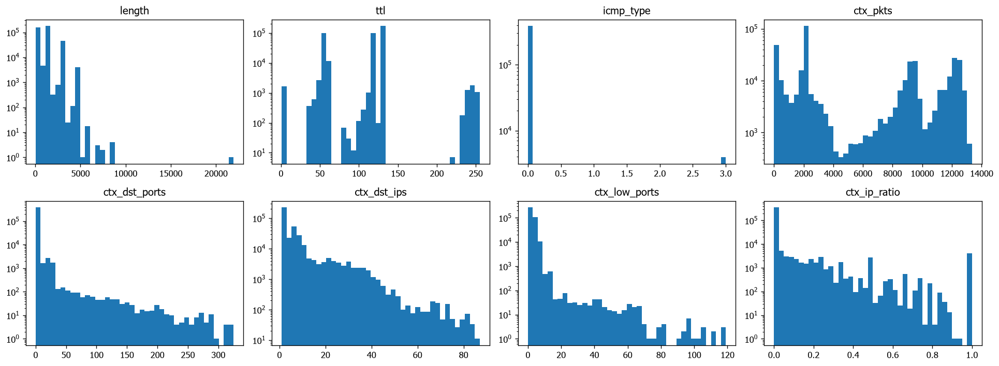
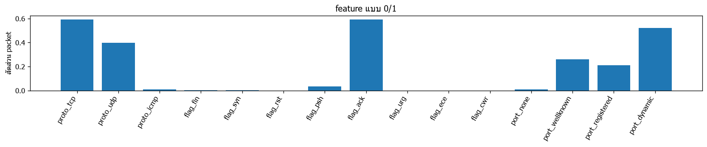
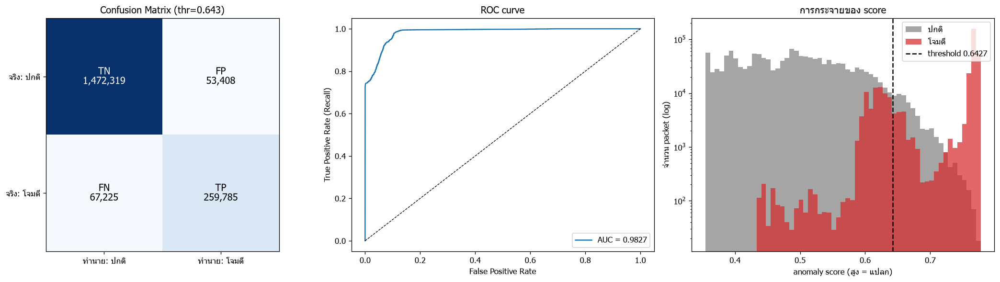

# ผลการเทรน 2026-11-12 22:06:54

## ตั้งค่า

| window_sec | n_estimators | seed | fp_quantile | max_packets/pcap | USE_SYNTHETIC | USE_CAPTURED | USE_SIM_TEST | DROP_ICMP_ECHO | THRESHOLD_MODE | MAX_TRAIN_PER_SOURCE | ICMP_MIN_FRAC |
|---|---|---|---|---|---|---|---|---|---|---|---|
| 5 | 200 | 42 | 0.9980 | 2000000 | True | True | True | True | recommended | 200000 | 0.0100 |

extra normal: `['home_discord_normal.csv']` | extra test: `['home_test_session2.csv']`

time windows: `{'Friday-WorkingHours': ['2017-07-07T13:50:00-03:00', '2017-07-07T15:35:00-03:00']}`

## ข้อมูลเทรน (traffic ปกติ)

| ไฟล์ | packets ทั้งไฟล์ | ตัด ping | ใช้เทรน | TCP | UDP | ICMP | อื่นๆ |
|---|---|---|---|---|---|---|---|
| normal_packets.csv | 8000 | 0 | 8000 | 6347 | 1626 | 27 | 0 |
| normal__Monday-WorkingHours.csv | 2000000 | 6 | 200000 | 195076 | 4924 | 0 | 0 |
| captured_packets.csv | 33160 | 0 | 33160 | 30082 | 3043 | 0 | 35 |
| home_discord_normal.csv | 146497 | 0 | 146497 | 835 | 145662 | 0 | 0 |

ICMP (ไม่ใช่ ping): 27 แถว (0.0070%) -> ทำสำเนาเพิ่ม 3,889 แถว ให้ได้ 1.00%

รวม 391,546 packets x 23 features

## การกระจายของ feature

## เทรน

ใช้เวลา 11.3s | score ข้อมูลเทรน: median=0.375 p99=0.606 max=0.755

## ชุดทดสอบ

| ชุด | packets | ติด label โจมตี |
|---|---|---|
| จำลอง (ping + nmap) | 5984 | 1984 |
| test__Friday-WorkingHours.csv | 1624499 | 324062 |
| home_test_session2.csv | 222254 | 964 |

รวม 1,852,737 packets | ปกติ 1,525,727 | โจมตี 327,010

กฎใน labels.csv: 3 ข้อ

## Threshold

- recommended = 0.6427 (OK: แยก ping ออกจาก traffic ปกติได้ (ใช้ค่ากึ่งกลางช่องว่าง))
- best_f1 = 0.7106
- **ใช้ 0.6427** (โหมด recommended)

| threshold | TP | FP | TN | FN | Accuracy | Precision | Recall (TPR) | F1 | FPR |
|---|---|---|---|---|---|---|---|---|---|
| 0.5500 | 325540 | 367069 | 1158658 | 1470 | 0.8011 | 0.4700 | 0.9955 | 0.6386 | 0.2406 |
| 0.5700 | 325349 | 269118 | 1256609 | 1661 | 0.8538 | 0.5473 | 0.9949 | 0.7061 | 0.1764 |
| 0.5900 | 324185 | 192589 | 1333138 | 2825 | 0.8945 | 0.6273 | 0.9914 | 0.7684 | 0.1262 |
| 0.6100 | 306575 | 121755 | 1403972 | 20435 | 0.9233 | 0.7157 | 0.9375 | 0.8118 | 0.0798 |
| 0.6300 | 273812 | 72172 | 1453555 | 53198 | 0.9323 | 0.7914 | 0.8373 | 0.8137 | 0.0473 |
| 0.6427 | 259784 | 53381 | 1472346 | 67226 | 0.9349 | 0.8295 | 0.7944 | 0.8116 | 0.0350 |
| 0.6500 | 255833 | 44302 | 1481425 | 71177 | 0.9377 | 0.8524 | 0.7823 | 0.8159 | 0.0290 |
| 0.6700 | 246060 | 20596 | 1505131 | 80950 | 0.9452 | 0.9228 | 0.7525 | 0.8290 | 0.0135 |
| 0.6900 | 243537 | 9897 | 1515830 | 83473 | 0.9496 | 0.9609 | 0.7447 | 0.8391 | 0.0065 |
| 0.7100 | 242829 | 4171 | 1521556 | 84181 | 0.9523 | 0.9831 | 0.7426 | 0.8461 | 0.0027 |
| 0.7106 | 242778 | 4070 | 1521657 | 84232 | 0.9523 | 0.9835 | 0.7424 | 0.8461 | 0.0027 |
| 0.7300 | 240804 | 1511 | 1524216 | 86206 | 0.9527 | 0.9938 | 0.7364 | 0.8459 | 0.0010 |
| 0.7500 | 237628 | 478 | 1525249 | 89382 | 0.9515 | 0.9980 | 0.7267 | 0.8410 | 0.0003 |

## ผลการวัด

### Confusion Matrix (threshold = 0.6427)
| | ทำนาย: ปกติ | ทำนาย: โจมตี |
|---|---|---|
| **จริง: ปกติ** | TN = 1,472,319 | FP = 53,408 |
| **จริง: โจมตี** | FN = 67,225 | TP = 259,785 |

- **TP** จับการโจมตีได้ถูก · **FN** การโจมตีที่หลุด
- **FP** alert หลอก (ปกติแต่ถูกมองว่าแปลก) · **TN** ปกติและตอบว่าปกติ

### Metrics
| metric | ค่า |
|---|---|
| Accuracy | 0.9349 |
| Precision | 0.8295 |
| Recall (TPR) | 0.7944 |
| F1 | 0.8116 |
| FPR | 0.0350 |
| Specificity (TNR) | 0.9650 |
| Balanced Acc | 0.8797 |
| ROC-AUC | 0.9827 |

### แยกตาม label
(แถว normal = อัตรา alert หลอก, แถวโจมตี = อัตราที่จับได้)

| label | packets | ถูกมองว่าแปลก | อัตรา |
|---|---|---|---|
| normal | 1525727 | 53408 | 0.0350 |
| Ping-iPhone | 12 | 12 | 1.0000 |
| PortScan | 324062 | 257053 | 0.7932 |
| PortScan-Fing | 952 | 942 | 0.9895 |
| nmap: nmap -sS 100 port | 100 | 92 | 0.9200 |
| nmap: nmap -sS 1000 port | 1000 | 992 | 0.9920 |
| nmap: nmap -sS ไล่ host (port 22 x100) | 100 | 98 | 0.9800 |
| nmap: nmap -sT (connect) 200 port | 200 | 191 | 0.9550 |
| nmap: nmap -sU (UDP) 100 port | 100 | 62 | 0.6200 |
| nmap: nmap -sn ไล่ host (ping sweep) | 400 | 259 | 0.6475 |
| ping: ping จากเครื่อง Linux/Mac | 8 | 8 | 1.0000 |
| ping: ping จากเครื่อง Windows | 8 | 8 | 1.0000 |
| ping: ping ตัวเอง (loopback, Windows) | 8 | 8 | 1.0000 |
| ping: ping รัว (flood เล็กน้อย) | 60 | 60 | 1.0000 |

## กราฟ Confusion Matrix / ROC / score

## บันทึกโมเดล

- model_path: `C:\Project_AI\Project-AI-IDS\system\models\iforest.joblib`
- scaler_path: `C:\Project_AI\Project-AI-IDS\system\models\scaler.joblib`
- meta_path: `C:\Project_AI\Project-AI-IDS\system\models\meta.json`
- แหล่งข้อมูลเทรน: normal_packets.csv, normal__Monday-WorkingHours.csv, captured_packets.csv, home_discord_normal.csv
