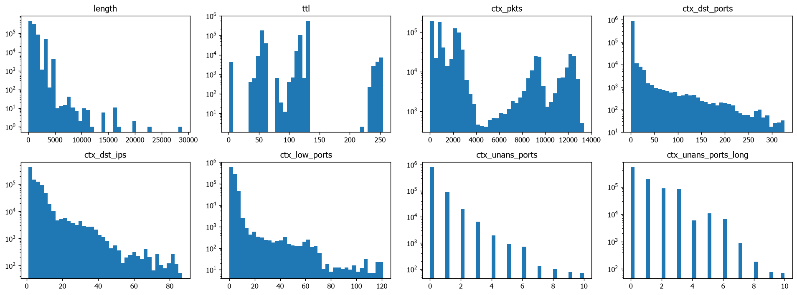
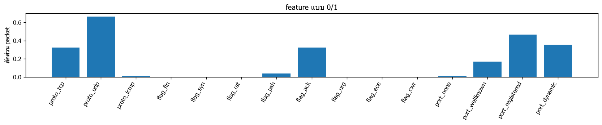
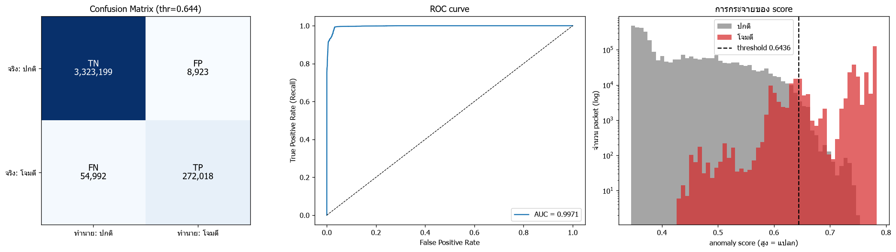

# ผลการเทรน 2026-11-13 14:26:59

## ตั้งค่า

| window_sec | n_estimators | seed | fp_quantile | max_packets/pcap | USE_SYNTHETIC | USE_CAPTURED | USE_SIM_TEST | DROP_ICMP_ECHO | THRESHOLD_MODE | MAX_TRAIN_PER_SOURCE | ICMP_MIN_FRAC | EXTRA_SYNTHETIC | FEATURE_VERSION |
|---|---|---|---|---|---|---|---|---|---|---|---|---|---|
| 5 | 1000 | 42 | 0.9980 | 2000000 | True | True | True | True | recommended | 200000 | 0.0100 | 40000 | 3 |

extra normal: `['home_discord_normal.csv', 'soak_active1_train.csv', 'soak_night1_train.csv']` | extra test: `['home_test_session2.csv', 'soak_active1_test.csv', 'soak_night1_test.csv']`

time windows: `{'Friday-WorkingHours': ['2017-07-07T13:50:00-03:00', '2017-07-07T15:35:00-03:00']}`

## ข้อมูลเทรน (traffic ปกติ)

| ไฟล์ | packets ทั้งไฟล์ | ตัด ping | ใช้เทรน | TCP | UDP | ICMP | อื่นๆ |
|---|---|---|---|---|---|---|---|
| normal_packets.csv | 8000 | 0 | 8000 | 6347 | 1626 | 27 | 0 |
| normal__Monday-WorkingHours.csv | 2000000 | 6 | 250215 | 200000 | 50140 | 0 | 75 |
| captured_packets.csv | 33160 | 0 | 33160 | 30082 | 3043 | 0 | 35 |
| home_discord_normal.csv | 146497 | 0 | 146497 | 835 | 145662 | 0 | 0 |
| soak_active1_train.csv | 1587441 | 4 | 219022 | 19013 | 200000 | 9 | 0 |
| soak_night1_train.csv | 1070773 | 0 | 208673 | 8672 | 200000 | 1 | 0 |
| synthetic เพิ่ม (seed 777) | 40000 | 0 | 40000 | 31927 | 7955 | 118 | 0 |

ICMP (ไม่ใช่ ping): 155 แถว (0.0171%) -> ทำสำเนาเพิ่ม 8,991 แถว ให้ได้ 1.00%

รวม 914,558 packets x 25 features

## การกระจายของ feature

## เทรน

ใช้เวลา 71.7s | score ข้อมูลเทรน: median=0.377 p99=0.581 max=0.759

## ชุดทดสอบ

| ชุด | packets | ติด label โจมตี | ชั่วโมง |
|---|---|---|---|
| จำลอง (ping + nmap) | 5984 | 1984 | - |
| test__Friday-WorkingHours.csv | 1624499 | 324062 | 1.7500 |
| home_test_session2.csv | 222254 | 964 | 0.0700 |
| soak_active1_test.csv | 821434 | 0 | 0.3400 |
| soak_night1_test.csv | 984961 | 0 | 1.6300 |

รวม 3,659,132 packets | ปกติ 3,332,122 | โจมตี 327,010

กฎใน labels.csv: 3 ข้อ

## Threshold

- recommended = 0.6436 (OK: แยก ping ออกจาก traffic ปกติได้ (วางที่ 25% ของช่องว่างจากฝั่งปกติ))
- best_f1 = 0.6292
- **ใช้ 0.6436** (โหมด recommended)

| threshold | TP | FP | TN | FN | Accuracy | Precision | Recall (TPR) | F1 | FPR |
|---|---|---|---|---|---|---|---|---|---|
| 0.5500 | 325848 | 260350 | 3071772 | 1162 | 0.9285 | 0.5559 | 0.9964 | 0.7136 | 0.0781 |
| 0.5700 | 325687 | 176710 | 3155412 | 1323 | 0.9513 | 0.6483 | 0.9960 | 0.7853 | 0.0530 |
| 0.5900 | 323961 | 105296 | 3226826 | 3049 | 0.9704 | 0.7547 | 0.9907 | 0.8567 | 0.0316 |
| 0.6100 | 305813 | 54285 | 3277837 | 21197 | 0.9794 | 0.8492 | 0.9352 | 0.8901 | 0.0163 |
| 0.6292 | 299822 | 22369 | 3309753 | 27188 | 0.9865 | 0.9306 | 0.9169 | 0.9237 | 0.0067 |
| 0.6300 | 298896 | 20904 | 3311218 | 28114 | 0.9866 | 0.9346 | 0.9140 | 0.9242 | 0.0063 |
| 0.6436 | 272095 | 8982 | 3323140 | 54915 | 0.9825 | 0.9680 | 0.8321 | 0.8949 | 0.0027 |
| 0.6500 | 259050 | 6370 | 3325752 | 67960 | 0.9797 | 0.9760 | 0.7922 | 0.8745 | 0.0019 |
| 0.6700 | 248320 | 1302 | 3330820 | 78690 | 0.9781 | 0.9948 | 0.7594 | 0.8613 | 0.0004 |
| 0.6900 | 245681 | 513 | 3331609 | 81329 | 0.9776 | 0.9979 | 0.7513 | 0.8572 | 0.0002 |
| 0.7100 | 243714 | 233 | 3331889 | 83296 | 0.9772 | 0.9990 | 0.7453 | 0.8537 | 0.0001 |
| 0.7300 | 237653 | 86 | 3332036 | 89357 | 0.9756 | 0.9996 | 0.7267 | 0.8416 | 0.0000 |
| 0.7500 | 163726 | 2 | 3332120 | 163284 | 0.9554 | 1.0000 | 0.5007 | 0.6673 | 0.0000 |

## แยกตามชุดทดสอบ

| ชุด | packets ปกติ | packet หลอก | อัตรา alert หลอก | packet หลอก/ชม. | packets โจมตี | จับได้ |
|---|---|---|---|---|---|---|
| จำลอง (ping + nmap) | 4000 | 11 | 0.0027 | - | 1984 | 0.8886 |
| test__Friday-WorkingHours.csv | 1300437 | 8884 | 0.0068 | 5076.7000 | 324062 | 0.8310 |
| home_test_session2.csv | 221290 | 0 | 0.0000 | 0.0000 | 964 | 0.9959 |
| soak_active1_test.csv | 821434 | 28 | 0.0000 | 82.5000 | 0 | - |
| soak_night1_test.csv | 984961 | 0 | 0.0000 | 0.0000 | 0 | - |

## ผลการวัด

### Confusion Matrix (threshold = 0.6436)
| | ทำนาย: ปกติ | ทำนาย: โจมตี |
|---|---|---|
| **จริง: ปกติ** | TN = 3,323,199 | FP = 8,923 |
| **จริง: โจมตี** | FN = 54,992 | TP = 272,018 |

- **TP** จับการโจมตีได้ถูก · **FN** การโจมตีที่หลุด
- **FP** alert หลอก (ปกติแต่ถูกมองว่าแปลก) · **TN** ปกติและตอบว่าปกติ

### Metrics
| metric | ค่า |
|---|---|
| Accuracy | 0.9825 |
| Precision | 0.9682 |
| Recall (TPR) | 0.8318 |
| F1 | 0.8949 |
| FPR | 0.0027 |
| Specificity (TNR) | 0.9973 |
| Balanced Acc | 0.9146 |
| ROC-AUC | 0.9971 |

### แยกตาม label
(แถว normal = อัตรา alert หลอก, แถวโจมตี = อัตราที่จับได้)

| label | packets | ถูกมองว่าแปลก | อัตรา |
|---|---|---|---|
| normal | 3332122 | 8923 | 0.0027 |
| Ping-iPhone | 12 | 12 | 1.0000 |
| PortScan | 324062 | 269295 | 0.8310 |
| PortScan-Fing | 952 | 948 | 0.9958 |
| nmap: nmap -sS 100 port | 100 | 100 | 1.0000 |
| nmap: nmap -sS 1000 port | 1000 | 1000 | 1.0000 |
| nmap: nmap -sS ไล่ host (port 22 x100) | 100 | 90 | 0.9000 |
| nmap: nmap -sT (connect) 200 port | 200 | 200 | 1.0000 |
| nmap: nmap -sU (UDP) 100 port | 100 | 92 | 0.9200 |
| nmap: nmap -sn ไล่ host (ping sweep) | 400 | 236 | 0.5900 |
| ping: ping จากเครื่อง Linux/Mac | 8 | 5 | 0.6250 |
| ping: ping จากเครื่อง Windows | 8 | 5 | 0.6250 |
| ping: ping ตัวเอง (loopback, Windows) | 8 | 4 | 0.5000 |
| ping: ping รัว (flood เล็กน้อย) | 60 | 31 | 0.5167 |

## เกณฑ์ผ่านตาม README

| เกณฑ์ | ผล | ผ่าน |
|---|---|---|
| ping (request) ping ตัวเอง (loopback, Windows) | 100% | True |
| ping (request) ping จากเครื่อง Windows | 100% | True |
| ping (request) ping จากเครื่อง Linux/Mac | 100% | True |
| ping (request) ping รัว (flood เล็กน้อย) | 100% | True |
| nmap -sS 100 port จับได้ภายใน 40 packet แรก | packet ที่ 1 (จับได้ 100%) | True |
| nmap -sS 1000 port จับได้ภายใน 40 packet แรก | packet ที่ 1 (จับได้ 100%) | True |
| nmap -sT (connect) 200 port จับได้ภายใน 40 packet แรก | packet ที่ 1 (จับได้ 100%) | True |
| nmap -sU (UDP) 100 port จับได้ภายใน 40 packet แรก | packet ที่ 9 (จับได้ 92%) | True |
| nmap -sS ไล่ host (port 22 x100) จับได้ภายใน 40 packet แรก | packet ที่ 11 (จับได้ 90%) | True |
| nmap -sn ไล่ host (ping sweep) จับได้ภายใน 40 packet แรก | packet ที่ 1 (จับได้ 59%) | True |
| ของจริงในบ้าน: Ping-iPhone | 100.0% | True |
| ของจริงในบ้าน: PortScan-Fing | 99.6% | True |
| alert หลอก soak_active1_test.csv (ข้อมูล) | 28 packets (82.5/ชม.) | - |
| alert หลอก soak_night1_test.csv (ข้อมูล) | 0 packets (0.0/ชม.) | - |

**✅ ผ่านเกณฑ์ README ครบ**

## กราฟ Confusion Matrix / ROC / score

## บันทึกโมเดล

- model_path: `C:\Project_AI\Project-AI-IDS\system\models\iforest.joblib`
- scaler_path: `C:\Project_AI\Project-AI-IDS\system\models\scaler.joblib`
- meta_path: `C:\Project_AI\Project-AI-IDS\system\models\meta.json`
- แหล่งข้อมูลเทรน: normal_packets.csv, normal__Monday-WorkingHours.csv, captured_packets.csv, home_discord_normal.csv, soak_active1_train.csv, soak_night1_train.csv
