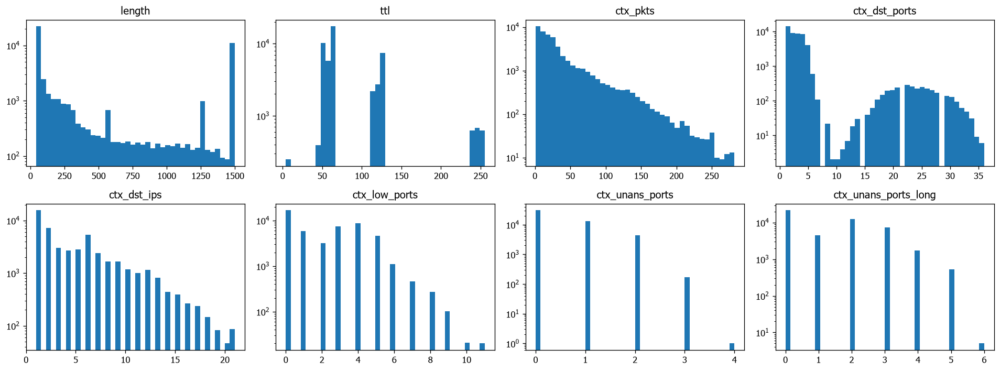
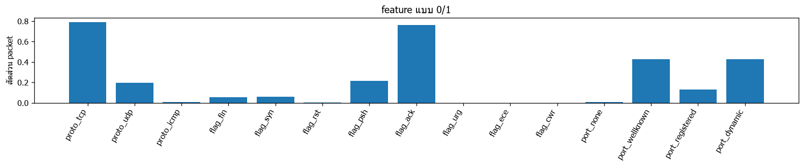
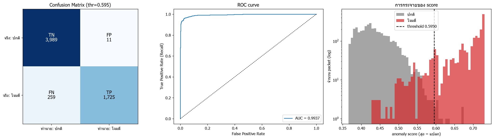

# ผลการเทรน 2026-11-16 09:27:51

## ตั้งค่า

| window_sec | n_estimators | seed | fp_quantile | max_packets/pcap | USE_SYNTHETIC | USE_CAPTURED | USE_SIM_TEST | DROP_ICMP_ECHO | THRESHOLD_MODE | MAX_TRAIN_PER_SOURCE | ICMP_MIN_FRAC | EXTRA_SYNTHETIC | FEATURE_VERSION |
|---|---|---|---|---|---|---|---|---|---|---|---|---|---|
| 5 | 1000 | 42 | 0.9980 | 2000000 | True | True | True | True | recommended | 200000 | 0.0100 | 40000 | 4 |

extra normal: `['home_discord_normal.csv', 'soak_active1_train.csv', 'soak_night1_train.csv']` | extra test: `['home_test_session2.csv', 'soak_active1_test.csv', 'soak_night1_test.csv']`

time windows: `{'Friday-WorkingHours': ['2017-07-07T13:50:00-03:00', '2017-07-07T15:35:00-03:00']}`

## ข้อมูลเทรน (traffic ปกติ)

| ไฟล์ | packets ทั้งไฟล์ | ตัด ping | ใช้เทรน | TCP | UDP | ICMP | อื่นๆ |
|---|---|---|---|---|---|---|---|
| normal_packets.csv | 8000 | 0 | 8000 | 6347 | 1626 | 27 | 0 |
| synthetic เพิ่ม (seed 777) | 40000 | 0 | 40000 | 31927 | 7955 | 118 | 0 |

ICMP (ไม่ใช่ ping): 145 แถว (0.3021%) -> ทำสำเนาเพิ่ม 339 แถว ให้ได้ 1.00%

รวม 48,339 packets x 32 features

## การกระจายของ feature

## เทรน

ใช้เวลา 30.2s | score ข้อมูลเทรน: median=0.426 p99=0.568 max=0.678

## ชุดทดสอบ

| ชุด | packets | ติด label โจมตี | ชั่วโมง |
|---|---|---|---|
| จำลอง (ping + nmap) | 5984 | 1984 | - |

รวม 5,984 packets | ปกติ 4,000 | โจมตี 1,984

กฎใน labels.csv: 3 ข้อ

## Threshold

- recommended = 0.5950 (OK: แยก ping ออกจาก traffic ปกติได้ (วางที่ 25% ของช่องว่างจากฝั่งปกติ))
- best_f1 = 0.5529
- **ใช้ 0.5950** (โหมด recommended)

| threshold | TP | FP | TN | FN | Accuracy | Precision | Recall (TPR) | F1 | FPR |
|---|---|---|---|---|---|---|---|---|---|
| 0.5500 | 1861 | 59 | 3941 | 123 | 0.9696 | 0.9693 | 0.9380 | 0.9534 | 0.0147 |
| 0.5529 | 1860 | 50 | 3950 | 124 | 0.9709 | 0.9738 | 0.9375 | 0.9553 | 0.0125 |
| 0.5700 | 1822 | 24 | 3976 | 162 | 0.9689 | 0.9870 | 0.9183 | 0.9514 | 0.0060 |
| 0.5900 | 1759 | 14 | 3986 | 225 | 0.9601 | 0.9921 | 0.8866 | 0.9364 | 0.0035 |
| 0.5950 | 1725 | 11 | 3989 | 259 | 0.9549 | 0.9937 | 0.8695 | 0.9274 | 0.0027 |
| 0.6100 | 1622 | 5 | 3995 | 362 | 0.9387 | 0.9969 | 0.8175 | 0.8984 | 0.0013 |
| 0.6300 | 1556 | 3 | 3997 | 428 | 0.9280 | 0.9981 | 0.7843 | 0.8784 | 0.0008 |
| 0.6500 | 1471 | 2 | 3998 | 513 | 0.9139 | 0.9986 | 0.7414 | 0.8510 | 0.0005 |
| 0.6700 | 1347 | 1 | 3999 | 637 | 0.8934 | 0.9993 | 0.6789 | 0.8085 | 0.0003 |
| 0.6900 | 1153 | 0 | 4000 | 831 | 0.8611 | 1.0000 | 0.5811 | 0.7351 | 0.0000 |
| 0.7100 | 849 | 0 | 4000 | 1135 | 0.8103 | 1.0000 | 0.4279 | 0.5994 | 0.0000 |
| 0.7300 | 3 | 0 | 4000 | 1981 | 0.6690 | 1.0000 | 0.0015 | 0.0030 | 0.0000 |
| 0.7500 | 0 | 0 | 4000 | 1984 | 0.6684 | 0.0000 | 0.0000 | 0.0000 | 0.0000 |

## แยกตามชุดทดสอบ

| ชุด | packets ปกติ | packet หลอก | อัตรา alert หลอก | packet หลอก/ชม. | packets โจมตี | จับได้ |
|---|---|---|---|---|---|---|
| จำลอง (ping + nmap) | 4000 | 11 | 0.0027 | - | 1984 | 0.8695 |

## ผลการวัด

### Confusion Matrix (threshold = 0.5950)
| | ทำนาย: ปกติ | ทำนาย: โจมตี |
|---|---|---|
| **จริง: ปกติ** | TN = 3,989 | FP = 11 |
| **จริง: โจมตี** | FN = 259 | TP = 1,725 |

- **TP** จับการโจมตีได้ถูก · **FN** การโจมตีที่หลุด
- **FP** alert หลอก (ปกติแต่ถูกมองว่าแปลก) · **TN** ปกติและตอบว่าปกติ

### Metrics
| metric | ค่า |
|---|---|
| Accuracy | 0.9549 |
| Precision | 0.9937 |
| Recall (TPR) | 0.8695 |
| F1 | 0.9274 |
| FPR | 0.0027 |
| Specificity (TNR) | 0.9972 |
| Balanced Acc | 0.9334 |
| ROC-AUC | 0.9937 |

### แยกตาม label
(แถว normal = อัตรา alert หลอก, แถวโจมตี = อัตราที่จับได้)

| label | packets | ถูกมองว่าแปลก | อัตรา |
|---|---|---|---|
| normal | 4000 | 11 | 0.0027 |
| nmap: nmap -sS 100 port | 100 | 97 | 0.9700 |
| nmap: nmap -sS 1000 port | 1000 | 997 | 0.9970 |
| nmap: nmap -sS ไล่ host (port 22 x100) | 100 | 61 | 0.6100 |
| nmap: nmap -sT (connect) 200 port | 200 | 197 | 0.9850 |
| nmap: nmap -sU (UDP) 100 port | 100 | 95 | 0.9500 |
| nmap: nmap -sn ไล่ host (ping sweep) | 400 | 235 | 0.5875 |
| ping: ping จากเครื่อง Linux/Mac | 8 | 4 | 0.5000 |
| ping: ping จากเครื่อง Windows | 8 | 5 | 0.6250 |
| ping: ping ตัวเอง (loopback, Windows) | 8 | 4 | 0.5000 |
| ping: ping รัว (flood เล็กน้อย) | 60 | 30 | 0.5000 |

## เกณฑ์ผ่านตาม README

| เกณฑ์ | ผล | ผ่าน |
|---|---|---|
| ping (request) ping ตัวเอง (loopback, Windows) | 100% | True |
| ping (request) ping จากเครื่อง Windows | 100% | True |
| ping (request) ping จากเครื่อง Linux/Mac | 100% | True |
| ping (request) ping รัว (flood เล็กน้อย) | 100% | True |
| nmap -sS 100 port จับได้ภายใน 40 packet แรก | packet ที่ 4 (จับได้ 97%) | True |
| nmap -sS 1000 port จับได้ภายใน 40 packet แรก | packet ที่ 4 (จับได้ 100%) | True |
| nmap -sT (connect) 200 port จับได้ภายใน 40 packet แรก | packet ที่ 4 (จับได้ 98%) | True |
| nmap -sU (UDP) 100 port จับได้ภายใน 40 packet แรก | packet ที่ 6 (จับได้ 95%) | True |
| nmap -sS ไล่ host (port 22 x100) จับได้ภายใน 40 packet แรก | packet ที่ 40 (จับได้ 61%) | True |
| nmap -sn ไล่ host (ping sweep) จับได้ภายใน 40 packet แรก | packet ที่ 1 (จับได้ 59%) | True |

**✅ ผ่านเกณฑ์ README ครบ**

## กราฟ Confusion Matrix / ROC / score

## บันทึกโมเดล

- model_path: `C:\Project_AI\home-nids\system\models\iforest.joblib`
- scaler_path: `C:\Project_AI\home-nids\system\models\scaler.joblib`
- meta_path: `C:\Project_AI\home-nids\system\models\meta.json`
- แหล่งข้อมูลเทรน: normal_packets.csv
