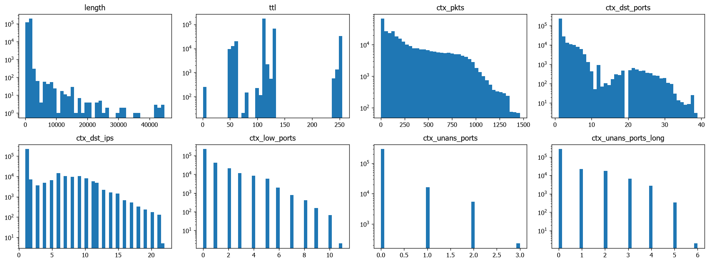
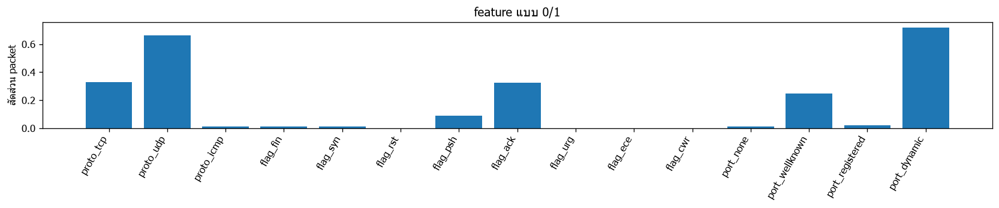
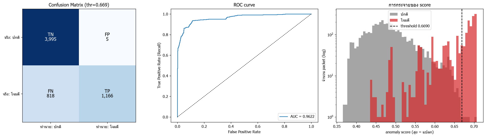

# ผลการเทรน 2026-11-16 15:05:26

## ตั้งค่า

| window_sec | n_estimators | seed | fp_quantile | max_packets/pcap | USE_SYNTHETIC | USE_CAPTURED | USE_SIM_TEST | DROP_ICMP_ECHO | THRESHOLD_MODE | MAX_TRAIN_PER_SOURCE | ICMP_MIN_FRAC | EXTRA_SYNTHETIC | FEATURE_VERSION |
|---|---|---|---|---|---|---|---|---|---|---|---|---|---|
| 5 | 1000 | 42 | 0.9980 | 2000000 | True | True | True | True | recommended | 200000 | 0.0100 | 40000 | 5 |

extra normal: `['home_discord_normal.csv', 'soak_active1_train.csv', 'soak_night1_train.csv']` | extra test: `['home_test_session2.csv', 'soak_active1_test.csv', 'soak_night1_test.csv']`

time windows: `{'Friday-WorkingHours': ['2017-07-07T13:50:00-03:00', '2017-07-07T15:35:00-03:00']}`

## ข้อมูลเทรน (traffic ปกติ)

| ไฟล์ | packets ทั้งไฟล์ | ตัด ping | ใช้เทรน | TCP | UDP | ICMP | อื่นๆ |
|---|---|---|---|---|---|---|---|
| normal_packets.csv | 8000 | 0 | 8000 | 6347 | 1626 | 27 | 0 |
| captured_full_v5.csv | 281027 | 0 | 267215 | 67204 | 200000 | 0 | 11 |
| synthetic เพิ่ม (seed 777) | 40000 | 0 | 40000 | 31350 | 8516 | 134 | 0 |

ICMP (ไม่ใช่ ping): 161 แถว (0.0511%) -> ทำสำเนาเพิ่ม 3,022 แถว ให้ได้ 1.00%

รวม 318,237 packets x 40 features

## การกระจายของ feature

## เทรน

ใช้เวลา 55.9s | score ข้อมูลเทรน: median=0.369 p99=0.584 max=0.720

## ชุดทดสอบ

| ชุด | packets | ติด label โจมตี | ชั่วโมง |
|---|---|---|---|
| จำลอง (ping + nmap) | 5984 | 1984 | - |

รวม 5,984 packets | ปกติ 4,000 | โจมตี 1,984

กฎใน labels.csv: 3 ข้อ

## Threshold

- recommended = 0.6690 (คำเตือน: ping บางตัวมี score ต่ำกว่า quantile ของ traffic ปกติ — ใช้ค่า quantile ของ traffic ปกติ (ping อาจหลุดบางตัว) ลองเพิ่มข้อมูล/ปรับ fp_quantile)
- best_f1 = 0.5927
- **ใช้ 0.6690** (โหมด recommended)

| threshold | TP | FP | TN | FN | Accuracy | Precision | Recall (TPR) | F1 | FPR |
|---|---|---|---|---|---|---|---|---|---|
| 0.5500 | 1860 | 483 | 3517 | 124 | 0.8986 | 0.7939 | 0.9375 | 0.8597 | 0.1207 |
| 0.5700 | 1730 | 317 | 3683 | 254 | 0.9046 | 0.8451 | 0.8720 | 0.8583 | 0.0793 |
| 0.5900 | 1710 | 202 | 3798 | 274 | 0.9205 | 0.8944 | 0.8619 | 0.8778 | 0.0505 |
| 0.5927 | 1702 | 190 | 3810 | 282 | 0.9211 | 0.8996 | 0.8579 | 0.8782 | 0.0475 |
| 0.6100 | 1568 | 137 | 3863 | 416 | 0.9076 | 0.9196 | 0.7903 | 0.8501 | 0.0343 |
| 0.6300 | 1459 | 74 | 3926 | 525 | 0.8999 | 0.9517 | 0.7354 | 0.8297 | 0.0185 |
| 0.6500 | 1326 | 16 | 3984 | 658 | 0.8874 | 0.9881 | 0.6683 | 0.7974 | 0.0040 |
| 0.6690 | 1167 | 5 | 3995 | 817 | 0.8626 | 0.9957 | 0.5882 | 0.7395 | 0.0013 |
| 0.6700 | 1157 | 4 | 3996 | 827 | 0.8611 | 0.9966 | 0.5832 | 0.7358 | 0.0010 |
| 0.6900 | 740 | 1 | 3999 | 1244 | 0.7919 | 0.9987 | 0.3730 | 0.5431 | 0.0003 |
| 0.7100 | 0 | 0 | 4000 | 1984 | 0.6684 | 0.0000 | 0.0000 | 0.0000 | 0.0000 |
| 0.7300 | 0 | 0 | 4000 | 1984 | 0.6684 | 0.0000 | 0.0000 | 0.0000 | 0.0000 |
| 0.7500 | 0 | 0 | 4000 | 1984 | 0.6684 | 0.0000 | 0.0000 | 0.0000 | 0.0000 |

## แยกตามชุดทดสอบ

| ชุด | packets ปกติ | packet หลอก | อัตรา alert หลอก | packet หลอก/ชม. | packets โจมตี | จับได้ |
|---|---|---|---|---|---|---|
| จำลอง (ping + nmap) | 4000 | 5 | 0.0013 | - | 1984 | 0.5877 |

## ผลการวัด

### Confusion Matrix (threshold = 0.6690)
| | ทำนาย: ปกติ | ทำนาย: โจมตี |
|---|---|---|
| **จริง: ปกติ** | TN = 3,995 | FP = 5 |
| **จริง: โจมตี** | FN = 818 | TP = 1,166 |

- **TP** จับการโจมตีได้ถูก · **FN** การโจมตีที่หลุด
- **FP** alert หลอก (ปกติแต่ถูกมองว่าแปลก) · **TN** ปกติและตอบว่าปกติ

### Metrics
| metric | ค่า |
|---|---|
| Accuracy | 0.8625 |
| Precision | 0.9957 |
| Recall (TPR) | 0.5877 |
| F1 | 0.7391 |
| FPR | 0.0013 |
| Specificity (TNR) | 0.9988 |
| Balanced Acc | 0.7932 |
| ROC-AUC | 0.9622 |

### แยกตาม label
(แถว normal = อัตรา alert หลอก, แถวโจมตี = อัตราที่จับได้)

| label | packets | ถูกมองว่าแปลก | อัตรา |
|---|---|---|---|
| normal | 4000 | 5 | 0.0013 |
| nmap: nmap -sS 100 port | 100 | 66 | 0.6600 |
| nmap: nmap -sS 1000 port | 1000 | 944 | 0.9440 |
| nmap: nmap -sS ไล่ host (port 22 x100) | 100 | 0 | 0.0000 |
| nmap: nmap -sT (connect) 200 port | 200 | 156 | 0.7800 |
| nmap: nmap -sU (UDP) 100 port | 100 | 0 | 0.0000 |
| nmap: nmap -sn ไล่ host (ping sweep) | 400 | 0 | 0.0000 |
| ping: ping จากเครื่อง Linux/Mac | 8 | 0 | 0.0000 |
| ping: ping จากเครื่อง Windows | 8 | 0 | 0.0000 |
| ping: ping ตัวเอง (loopback, Windows) | 8 | 0 | 0.0000 |
| ping: ping รัว (flood เล็กน้อย) | 60 | 0 | 0.0000 |

## เกณฑ์ผ่านตาม README

| เกณฑ์ | ผล | ผ่าน |
|---|---|---|
| ping (request) ping ตัวเอง (loopback, Windows) | 0% | False |
| ping (request) ping จากเครื่อง Windows | 0% | False |
| ping (request) ping จากเครื่อง Linux/Mac | 0% | False |
| ping (request) ping รัว (flood เล็กน้อย) | 0% | False |
| nmap -sS 100 port จับได้ภายใน 40 packet แรก | packet ที่ 21 (จับได้ 66%) | True |
| nmap -sS 1000 port จับได้ภายใน 40 packet แรก | packet ที่ 14 (จับได้ 94%) | True |
| nmap -sT (connect) 200 port จับได้ภายใน 40 packet แรก | packet ที่ 16 (จับได้ 78%) | True |
| nmap -sU (UDP) 100 port จับได้ภายใน 40 packet แรก | จับไม่ได้ | False |
| nmap -sS ไล่ host (port 22 x100) จับได้ภายใน 40 packet แรก | จับไม่ได้ | False |
| nmap -sn ไล่ host (ping sweep) จับได้ภายใน 40 packet แรก | จับไม่ได้ | False |

**❌ ไม่ผ่านเกณฑ์ README — อย่าเอาโมเดลนี้ไปใช้ (กู้โมเดลเดิมจาก backup)**

## กราฟ Confusion Matrix / ROC / score

## บันทึกโมเดล

- model_path: `C:\Project_AI\home-nids\system\models\iforest.joblib`
- scaler_path: `C:\Project_AI\home-nids\system\models\scaler.joblib`
- meta_path: `C:\Project_AI\home-nids\system\models\meta.json`
- แหล่งข้อมูลเทรน: normal_packets.csv, captured_full_v5.csv
