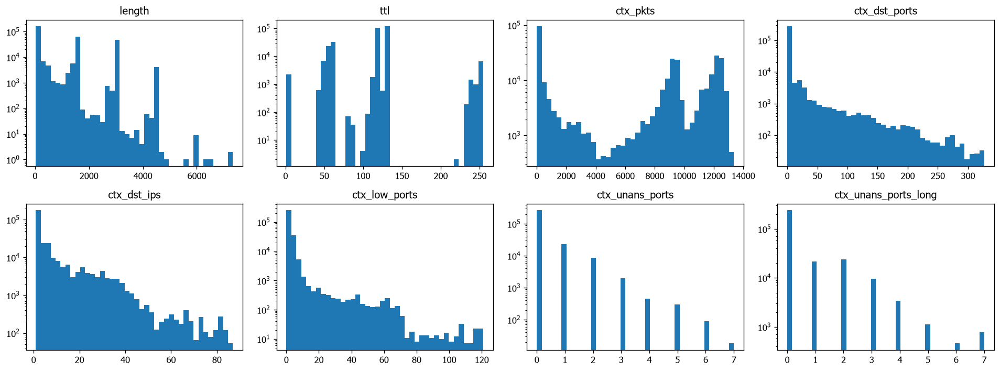
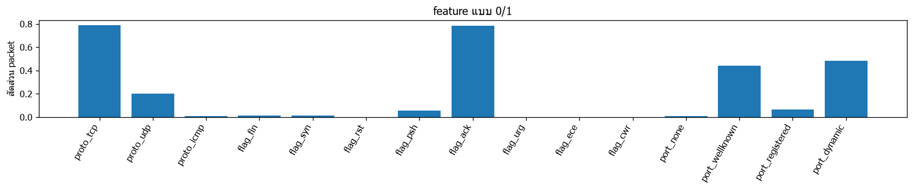
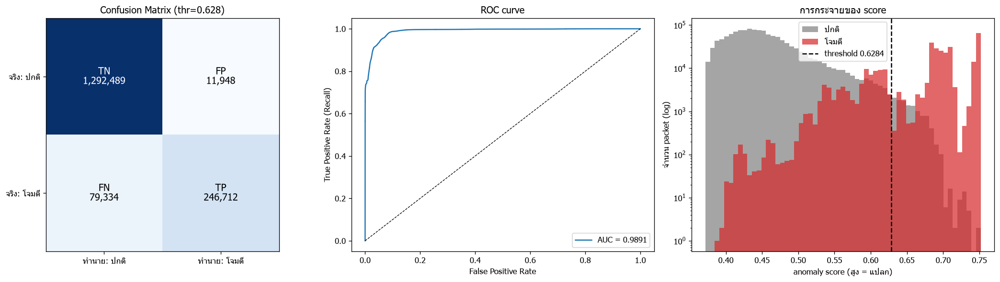

# ผลการเทรน 2026-11-17 19:15:11

## ตั้งค่า

| window_sec | n_estimators | seed | fp_quantile | max_packets/pcap | USE_SYNTHETIC | USE_CAPTURED | USE_SIM_TEST | DROP_ICMP_ECHO | THRESHOLD_MODE | MAX_TRAIN_PER_SOURCE | ICMP_MIN_FRAC | EXTRA_SYNTHETIC | FEATURE_VERSION |
|---|---|---|---|---|---|---|---|---|---|---|---|---|---|
| 5 | 1000 | 42 | 0.9980 | 2000000 | True | True | True | True | recommended | 200000 | 0.0100 | 40000 | 5 |

extra normal: `[]` | extra test: `[]`

time windows: `{'Friday-WorkingHours': ['2017-07-07T13:50:00-03:00', '2017-07-07T15:35:00-03:00']}`

## ข้อมูลเทรน (traffic ปกติ)

| ไฟล์ | packets ทั้งไฟล์ | ตัด ping | ใช้เทรน | TCP | UDP | ICMP | อื่นๆ |
|---|---|---|---|---|---|---|---|
| normal_packets.csv | 8000 | 0 | 8000 | 6402 | 1575 | 23 | 0 |
| normal__Monday-WorkingHours.csv | 2000000 | 6 | 250215 | 200000 | 50140 | 0 | 75 |
| synthetic เพิ่ม (seed 777) | 40000 | 0 | 40000 | 31350 | 8516 | 134 | 0 |

ICMP (ไม่ใช่ ping): 157 แถว (0.0526%) -> ทำสำเนาเพิ่ม 2,854 แถว ให้ได้ 1.00%

รวม 301,069 packets x 40 features

## การกระจายของ feature

## เทรน

ใช้เวลา 36.1s | score ข้อมูลเทรน: median=0.384 p99=0.559 max=0.700

## ชุดทดสอบ

| ชุด | packets | ติด label โจมตี | ชั่วโมง |
|---|---|---|---|
| จำลอง (ping + nmap) | 5984 | 1984 | - |
| test__Friday-WorkingHours.csv | 1624499 | 324062 | 1.7500 |

รวม 1,630,483 packets | ปกติ 1,304,437 | โจมตี 326,046

กฎใน labels.csv: 3 ข้อ

## Threshold

- recommended = 0.6284 (คำเตือน: ping บางตัวมี score ต่ำกว่า quantile ของ traffic ปกติ — ใช้ค่า quantile ของ traffic ปกติ (ping อาจหลุดบางตัว) ลองเพิ่มข้อมูล/ปรับ fp_quantile)
- best_f1 = 0.5893
- **ใช้ 0.6284** (โหมด recommended)

| threshold | TP | FP | TN | FN | Accuracy | Precision | Recall (TPR) | F1 | FPR |
|---|---|---|---|---|---|---|---|---|---|
| 0.5500 | 311307 | 83563 | 1220874 | 14739 | 0.9397 | 0.7884 | 0.9548 | 0.8636 | 0.0641 |
| 0.5700 | 301109 | 55834 | 1248603 | 24937 | 0.9505 | 0.8436 | 0.9235 | 0.8817 | 0.0428 |
| 0.5893 | 294156 | 37761 | 1266676 | 31890 | 0.9573 | 0.8862 | 0.9022 | 0.8941 | 0.0289 |
| 0.5900 | 293602 | 37156 | 1267281 | 32444 | 0.9573 | 0.8877 | 0.9005 | 0.8940 | 0.0285 |
| 0.6100 | 267643 | 21336 | 1283101 | 58403 | 0.9511 | 0.9262 | 0.8209 | 0.8703 | 0.0164 |
| 0.6284 | 246711 | 11935 | 1292502 | 79335 | 0.9440 | 0.9539 | 0.7567 | 0.8439 | 0.0091 |
| 0.6300 | 246644 | 11376 | 1293061 | 79402 | 0.9443 | 0.9559 | 0.7565 | 0.8446 | 0.0087 |
| 0.6500 | 241492 | 5705 | 1298732 | 84554 | 0.9446 | 0.9769 | 0.7407 | 0.8425 | 0.0044 |
| 0.6700 | 237337 | 2054 | 1302383 | 88709 | 0.9443 | 0.9914 | 0.7279 | 0.8395 | 0.0016 |
| 0.6900 | 181601 | 237 | 1304200 | 144445 | 0.9113 | 0.9987 | 0.5570 | 0.7151 | 0.0002 |
| 0.7100 | 96178 | 38 | 1304399 | 229868 | 0.8590 | 0.9996 | 0.2950 | 0.4555 | 0.0000 |
| 0.7300 | 80649 | 11 | 1304426 | 245397 | 0.8495 | 0.9999 | 0.2474 | 0.3966 | 0.0000 |
| 0.7500 | 32650 | 0 | 1304437 | 293396 | 0.8201 | 1.0000 | 0.1001 | 0.1820 | 0.0000 |

## แยกตามชุดทดสอบ

| ชุด | packets ปกติ | packet หลอก | อัตรา alert หลอก | packet หลอก/ชม. | packets โจมตี | จับได้ |
|---|---|---|---|---|---|---|
| จำลอง (ping + nmap) | 4000 | 5 | 0.0013 | - | 1984 | 0.5534 |
| test__Friday-WorkingHours.csv | 1300437 | 11943 | 0.0092 | 6824.7000 | 324062 | 0.7579 |

## ผลการวัด

### Confusion Matrix (threshold = 0.6284)
| | ทำนาย: ปกติ | ทำนาย: โจมตี |
|---|---|---|
| **จริง: ปกติ** | TN = 1,292,489 | FP = 11,948 |
| **จริง: โจมตี** | FN = 79,334 | TP = 246,712 |

- **TP** จับการโจมตีได้ถูก · **FN** การโจมตีที่หลุด
- **FP** alert หลอก (ปกติแต่ถูกมองว่าแปลก) · **TN** ปกติและตอบว่าปกติ

### Metrics
| metric | ค่า |
|---|---|
| Accuracy | 0.9440 |
| Precision | 0.9538 |
| Recall (TPR) | 0.7567 |
| F1 | 0.8439 |
| FPR | 0.0092 |
| Specificity (TNR) | 0.9908 |
| Balanced Acc | 0.8738 |
| ROC-AUC | 0.9891 |

### แยกตาม label
(แถว normal = อัตรา alert หลอก, แถวโจมตี = อัตราที่จับได้)

| label | packets | ถูกมองว่าแปลก | อัตรา |
|---|---|---|---|
| normal | 1304437 | 11948 | 0.0092 |
| PortScan | 324062 | 245614 | 0.7579 |
| nmap: nmap -sS 100 port | 100 | 32 | 0.3200 |
| nmap: nmap -sS 1000 port | 1000 | 936 | 0.9360 |
| nmap: nmap -sS ไล่ host (port 22 x100) | 100 | 0 | 0.0000 |
| nmap: nmap -sT (connect) 200 port | 200 | 130 | 0.6500 |
| nmap: nmap -sU (UDP) 100 port | 100 | 0 | 0.0000 |
| nmap: nmap -sn ไล่ host (ping sweep) | 400 | 0 | 0.0000 |
| ping: ping จากเครื่อง Linux/Mac | 8 | 0 | 0.0000 |
| ping: ping จากเครื่อง Windows | 8 | 0 | 0.0000 |
| ping: ping ตัวเอง (loopback, Windows) | 8 | 0 | 0.0000 |
| ping: ping รัว (flood เล็กน้อย) | 60 | 0 | 0.0000 |

## เกณฑ์ผ่านตาม README

| เกณฑ์ | ผล | ผ่าน |
|---|---|---|
| ping (request) ping ตัวเอง (loopback, Windows) | 0% | False |
| ping (request) ping จากเครื่อง Windows | 0% | False |
| ping (request) ping จากเครื่อง Linux/Mac | 0% | False |
| ping (request) ping รัว (flood เล็กน้อย) | 0% | False |
| nmap -sS 100 port จับได้ภายใน 40 packet แรก | packet ที่ 65 (จับได้ 32%) | False |
| nmap -sS 1000 port จับได้ภายใน 40 packet แรก | packet ที่ 60 (จับได้ 94%) | False |
| nmap -sT (connect) 200 port จับได้ภายใน 40 packet แรก | packet ที่ 68 (จับได้ 65%) | False |
| nmap -sU (UDP) 100 port จับได้ภายใน 40 packet แรก | จับไม่ได้ | False |
| nmap -sS ไล่ host (port 22 x100) จับได้ภายใน 40 packet แรก | จับไม่ได้ | False |
| nmap -sn ไล่ host (ping sweep) จับได้ภายใน 40 packet แรก | จับไม่ได้ | False |

**❌ ไม่ผ่านเกณฑ์ README — อย่าเอาโมเดลนี้ไปใช้ (กู้โมเดลเดิมจาก backup)**

## กราฟ Confusion Matrix / ROC / score

## บันทึกโมเดล

- model_path: `C:\Project_AI\Project-AI-IDS\system\models\iforest.joblib`
- scaler_path: `C:\Project_AI\Project-AI-IDS\system\models\scaler.joblib`
- meta_path: `C:\Project_AI\Project-AI-IDS\system\models\meta.json`
- แหล่งข้อมูลเทรน: normal_packets.csv, normal__Monday-WorkingHours.csv
