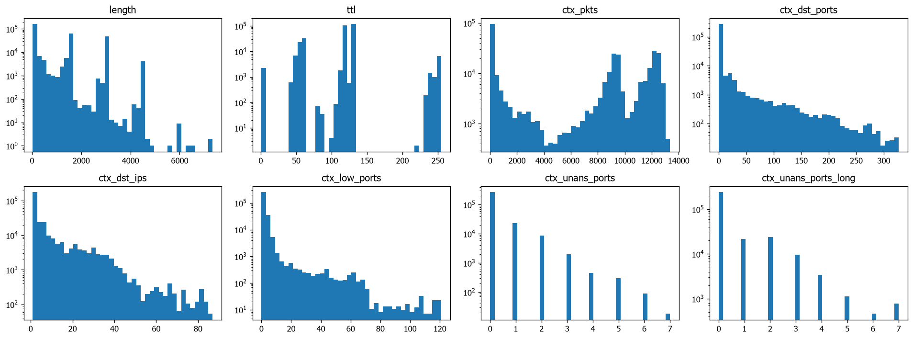
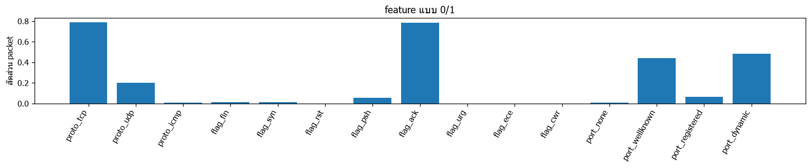
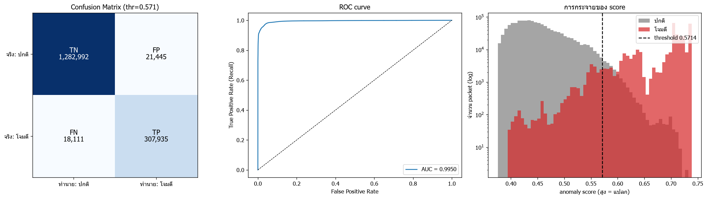

# ผลการเทรน 2026-11-17 21:05:17

## ตั้งค่า

| window_sec | n_estimators | seed | fp_quantile | max_packets/pcap | USE_SYNTHETIC | USE_CAPTURED | USE_SIM_TEST | DROP_ICMP_ECHO | THRESHOLD_MODE | MAX_TRAIN_PER_SOURCE | ICMP_MIN_FRAC | EXTRA_SYNTHETIC | FEATURE_VERSION |
|---|---|---|---|---|---|---|---|---|---|---|---|---|---|
| 5 | 1000 | 42 | 0.9980 | 2000000 | True | True | True | True | recommended | 200000 | 0.0100 | 40000 | 6 |

extra normal: `[]` | extra test: `[]`

time windows: `{'Friday-WorkingHours': ['2017-07-07T13:50:00-03:00', '2017-07-07T15:35:00-03:00']}`

## ข้อมูลเทรน (traffic ปกติ)

| ไฟล์ | packets ทั้งไฟล์ | ตัด ping | ใช้เทรน | TCP | UDP | ICMP | อื่นๆ |
|---|---|---|---|---|---|---|---|
| normal_packets.csv | 8000 | 0 | 8000 | 6402 | 1575 | 23 | 0 |
| normal__Monday-WorkingHours.csv | 2000000 | 6 | 250215 | 200000 | 50140 | 0 | 75 |
| synthetic เพิ่ม (seed 777) | 40000 | 0 | 40000 | 31350 | 8516 | 134 | 0 |

ICMP (ไม่ใช่ ping): 157 แถว (0.0526%) -> ทำสำเนาเพิ่ม 2,854 แถว ให้ได้ 1.00%

รวม 301,069 packets x 36 features

## การกระจายของ feature

## เทรน

ใช้เวลา 42.2s | score ข้อมูลเทรน: median=0.387 p99=0.538 max=0.658

## ชุดทดสอบ

| ชุด | packets | ติด label โจมตี | ชั่วโมง |
|---|---|---|---|
| จำลอง (ping + nmap) | 5984 | 1984 | - |
| test__Friday-WorkingHours.csv | 1624499 | 324062 | 1.7500 |

รวม 1,630,483 packets | ปกติ 1,304,437 | โจมตี 326,046

กฎใน labels.csv: 3 ข้อ

## Threshold

- recommended = 0.5714 (OK: แยก ping ออกจาก traffic ปกติได้ (วางที่ 25% ของช่องว่างจากฝั่งปกติ))
- best_f1 = 0.5992
- **ใช้ 0.5714** (โหมด recommended)

| threshold | TP | FP | TN | FN | Accuracy | Precision | Recall (TPR) | F1 | FPR |
|---|---|---|---|---|---|---|---|---|---|
| 0.5500 | 317372 | 49515 | 1254922 | 8674 | 0.9643 | 0.8650 | 0.9734 | 0.9160 | 0.0380 |
| 0.5700 | 308572 | 22627 | 1281810 | 17474 | 0.9754 | 0.9317 | 0.9464 | 0.9390 | 0.0173 |
| 0.5714 | 307923 | 21420 | 1283017 | 18123 | 0.9757 | 0.9350 | 0.9444 | 0.9397 | 0.0164 |
| 0.5900 | 299894 | 9476 | 1294961 | 26152 | 0.9781 | 0.9694 | 0.9198 | 0.9439 | 0.0073 |
| 0.5992 | 297328 | 5920 | 1298517 | 28718 | 0.9788 | 0.9805 | 0.9119 | 0.9450 | 0.0045 |
| 0.6100 | 290626 | 3439 | 1300998 | 35420 | 0.9762 | 0.9883 | 0.8914 | 0.9373 | 0.0026 |
| 0.6300 | 270165 | 1304 | 1303133 | 55881 | 0.9649 | 0.9952 | 0.8286 | 0.9043 | 0.0010 |
| 0.6500 | 245988 | 606 | 1303831 | 80058 | 0.9505 | 0.9975 | 0.7545 | 0.8591 | 0.0005 |
| 0.6700 | 241388 | 403 | 1304034 | 84658 | 0.9478 | 0.9983 | 0.7403 | 0.8502 | 0.0003 |
| 0.6900 | 232198 | 210 | 1304227 | 93848 | 0.9423 | 0.9991 | 0.7122 | 0.8316 | 0.0002 |
| 0.7100 | 140547 | 29 | 1304408 | 185499 | 0.8862 | 0.9998 | 0.4311 | 0.6024 | 0.0000 |
| 0.7300 | 62960 | 0 | 1304437 | 263086 | 0.8386 | 1.0000 | 0.1931 | 0.3237 | 0.0000 |
| 0.7500 | 0 | 0 | 1304437 | 326046 | 0.8000 | 0.0000 | 0.0000 | 0.0000 | 0.0000 |

## แยกตามชุดทดสอบ

| ชุด | packets ปกติ | packet หลอก | อัตรา alert หลอก | packet หลอก/ชม. | packets โจมตี | จับได้ |
|---|---|---|---|---|---|---|
| จำลอง (ping + nmap) | 4000 | 4 | 0.0010 | - | 1984 | 0.8291 |
| test__Friday-WorkingHours.csv | 1300437 | 21441 | 0.0165 | 12252.3000 | 324062 | 0.9452 |

## ผลการวัด

### Confusion Matrix (threshold = 0.5714)
| | ทำนาย: ปกติ | ทำนาย: โจมตี |
|---|---|---|
| **จริง: ปกติ** | TN = 1,282,992 | FP = 21,445 |
| **จริง: โจมตี** | FN = 18,111 | TP = 307,935 |

- **TP** จับการโจมตีได้ถูก · **FN** การโจมตีที่หลุด
- **FP** alert หลอก (ปกติแต่ถูกมองว่าแปลก) · **TN** ปกติและตอบว่าปกติ

### Metrics
| metric | ค่า |
|---|---|
| Accuracy | 0.9757 |
| Precision | 0.9349 |
| Recall (TPR) | 0.9445 |
| F1 | 0.9396 |
| FPR | 0.0164 |
| Specificity (TNR) | 0.9836 |
| Balanced Acc | 0.9640 |
| ROC-AUC | 0.9950 |

### แยกตาม label
(แถว normal = อัตรา alert หลอก, แถวโจมตี = อัตราที่จับได้)

| label | packets | ถูกมองว่าแปลก | อัตรา |
|---|---|---|---|
| normal | 1304437 | 21445 | 0.0164 |
| PortScan | 324062 | 306290 | 0.9452 |
| nmap: nmap -sS 100 port | 100 | 97 | 0.9700 |
| nmap: nmap -sS 1000 port | 1000 | 997 | 0.9970 |
| nmap: nmap -sS ไล่ host (port 22 x100) | 100 | 40 | 0.4000 |
| nmap: nmap -sT (connect) 200 port | 200 | 197 | 0.9850 |
| nmap: nmap -sU (UDP) 100 port | 100 | 67 | 0.6700 |
| nmap: nmap -sn ไล่ host (ping sweep) | 400 | 200 | 0.5000 |
| ping: ping จากเครื่อง Linux/Mac | 8 | 6 | 0.7500 |
| ping: ping จากเครื่อง Windows | 8 | 5 | 0.6250 |
| ping: ping ตัวเอง (loopback, Windows) | 8 | 4 | 0.5000 |
| ping: ping รัว (flood เล็กน้อย) | 60 | 32 | 0.5333 |

## เกณฑ์ผ่านตาม README

| เกณฑ์ | ผล | ผ่าน |
|---|---|---|
| ping (request) ping ตัวเอง (loopback, Windows) | 100% | True |
| ping (request) ping จากเครื่อง Windows | 100% | True |
| ping (request) ping จากเครื่อง Linux/Mac | 100% | True |
| ping (request) ping รัว (flood เล็กน้อย) | 100% | True |
| nmap -sS 100 port จับได้ภายใน 40 packet แรก | packet ที่ 4 (จับได้ 97%) | True |
| nmap -sS 1000 port จับได้ภายใน 40 packet แรก | packet ที่ 4 (จับได้ 100%) | True |
| nmap -sT (connect) 200 port จับได้ภายใน 40 packet แรก | packet ที่ 4 (จับได้ 98%) | True |
| nmap -sU (UDP) 100 port จับได้ภายใน 40 packet แรก | packet ที่ 30 (จับได้ 67%) | True |
| nmap -sS ไล่ host (port 22 x100) จับได้ภายใน 40 packet แรก | packet ที่ 61 (จับได้ 40%) | False |
| nmap -sn ไล่ host (ping sweep) จับได้ภายใน 40 packet แรก | packet ที่ 1 (จับได้ 50%) | True |

**❌ ไม่ผ่านเกณฑ์ README — อย่าเอาโมเดลนี้ไปใช้ (กู้โมเดลเดิมจาก backup)**

## กราฟ Confusion Matrix / ROC / score

## บันทึกโมเดล

- model_path: `C:\Project_AI\Project-AI-IDS\system\models\iforest.joblib`
- scaler_path: `C:\Project_AI\Project-AI-IDS\system\models\scaler.joblib`
- meta_path: `C:\Project_AI\Project-AI-IDS\system\models\meta.json`
- แหล่งข้อมูลเทรน: normal_packets.csv, normal__Monday-WorkingHours.csv
