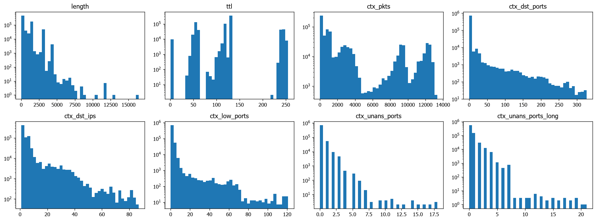
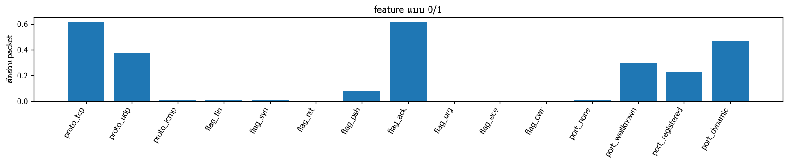
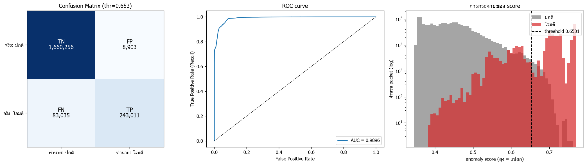

# ผลการเทรน 2026-11-18 23:22:07

## ตั้งค่า

| window_sec | n_estimators | seed | fp_quantile | max_packets/pcap | USE_SYNTHETIC | USE_CAPTURED | USE_SIM_TEST | DROP_ICMP_ECHO | THRESHOLD_MODE | MAX_TRAIN_PER_SOURCE | ICMP_MIN_FRAC | EXTRA_SYNTHETIC | FEATURE_VERSION |
|---|---|---|---|---|---|---|---|---|---|---|---|---|---|
| 5 | 1000 | 42 | 0.9980 | 2000000 | True | True | True | True | recommended | 200000 | 0.0100 | 40000 | 5 |

extra normal: `['captured_v5_active1_train.csv', 'captured_v5_night1_train.csv']` | extra test: `['captured_v5_active1_test.csv', 'captured_v5_night1_test.csv']`

time windows: `{'Friday-WorkingHours': ['2017-07-07T13:50:00-03:00', '2017-07-07T15:35:00-03:00']}`

## ข้อมูลเทรน (traffic ปกติ)

| ไฟล์ | packets ทั้งไฟล์ | ตัด ping | ใช้เทรน | TCP | UDP | ICMP | อื่นๆ |
|---|---|---|---|---|---|---|---|
| normal_packets.csv | 8000 | 0 | 8000 | 6402 | 1575 | 23 | 0 |
| normal__Monday-WorkingHours.csv | 2000000 | 6 | 250215 | 200000 | 50140 | 0 | 75 |
| captured_v5_active1_train.csv | 939703 | 0 | 226660 | 26658 | 200000 | 2 | 0 |
| captured_v5_night1_train.csv | 316278 | 0 | 218956 | 200000 | 18951 | 0 | 5 |
| synthetic เพิ่ม (seed 777) | 40000 | 0 | 40000 | 31350 | 8516 | 134 | 0 |

ICMP (ไม่ใช่ ping): 159 แถว (0.0214%) -> ทำสำเนาเพิ่ม 7,353 แถว ให้ได้ 1.00%

รวม 751,184 packets x 40 features

## การกระจายของ feature

## เทรน

ใช้เวลา 71.8s | score ข้อมูลเทรน: median=0.378 p99=0.549 max=0.706

## ชุดทดสอบ

| ชุด | packets | ติด label โจมตี | ชั่วโมง |
|---|---|---|---|
| จำลอง (ping + nmap) | 5984 | 1984 | - |
| test__Friday-WorkingHours.csv | 1624499 | 324062 | 1.7500 |
| captured_v5_active1_test.csv | 251770 | 0 | 0.4900 |
| captured_v5_night1_test.csv | 112952 | 0 | 5.3700 |

รวม 1,995,205 packets | ปกติ 1,669,159 | โจมตี 326,046

กฎใน labels.csv: 3 ข้อ

## Threshold

- recommended = 0.6531 (คำเตือน: ping บางตัวมี score ต่ำกว่า quantile ของ traffic ปกติ — ใช้ค่า quantile ของ traffic ปกติ (ping อาจหลุดบางตัว) ลองเพิ่มข้อมูล/ปรับ fp_quantile)
- best_f1 = 0.5890
- **ใช้ 0.6531** (โหมด recommended)

| threshold | TP | FP | TN | FN | Accuracy | Precision | Recall (TPR) | F1 | FPR |
|---|---|---|---|---|---|---|---|---|---|
| 0.5500 | 310285 | 107630 | 1561529 | 15761 | 0.9382 | 0.7425 | 0.9517 | 0.8341 | 0.0645 |
| 0.5700 | 301583 | 72257 | 1596902 | 24463 | 0.9515 | 0.8067 | 0.9250 | 0.8618 | 0.0433 |
| 0.5890 | 296439 | 49530 | 1619629 | 29607 | 0.9603 | 0.8568 | 0.9092 | 0.8822 | 0.0297 |
| 0.5900 | 295664 | 48407 | 1620752 | 30382 | 0.9605 | 0.8593 | 0.9068 | 0.8824 | 0.0290 |
| 0.6100 | 278360 | 34205 | 1634954 | 47686 | 0.9590 | 0.8906 | 0.8537 | 0.8718 | 0.0205 |
| 0.6300 | 253626 | 20376 | 1648783 | 72420 | 0.9535 | 0.9256 | 0.7779 | 0.8454 | 0.0122 |
| 0.6500 | 243719 | 9964 | 1659195 | 82327 | 0.9537 | 0.9607 | 0.7475 | 0.8408 | 0.0060 |
| 0.6531 | 243002 | 8896 | 1660263 | 83044 | 0.9539 | 0.9647 | 0.7453 | 0.8409 | 0.0053 |
| 0.6700 | 240836 | 4112 | 1665047 | 85210 | 0.9552 | 0.9832 | 0.7387 | 0.8436 | 0.0025 |
| 0.6900 | 232156 | 971 | 1668188 | 93890 | 0.9525 | 0.9958 | 0.7120 | 0.8304 | 0.0006 |
| 0.7100 | 160382 | 63 | 1669096 | 165664 | 0.9169 | 0.9996 | 0.4919 | 0.6593 | 0.0000 |
| 0.7300 | 88596 | 30 | 1669129 | 237450 | 0.8810 | 0.9997 | 0.2717 | 0.4273 | 0.0000 |
| 0.7500 | 80378 | 2 | 1669157 | 245668 | 0.8769 | 1.0000 | 0.2465 | 0.3955 | 0.0000 |

## แยกตามชุดทดสอบ

| ชุด | packets ปกติ | packet หลอก | อัตรา alert หลอก | packet หลอก/ชม. | packets โจมตี | จับได้ |
|---|---|---|---|---|---|---|
| จำลอง (ping + nmap) | 4000 | 4 | 0.0010 | - | 1984 | 0.5318 |
| test__Friday-WorkingHours.csv | 1300437 | 8895 | 0.0068 | 5083.0000 | 324062 | 0.7466 |
| captured_v5_active1_test.csv | 251770 | 1 | 0.0000 | 2.0000 | 0 | - |
| captured_v5_night1_test.csv | 112952 | 3 | 0.0000 | 0.6000 | 0 | - |

## ผลการวัด

### Confusion Matrix (threshold = 0.6531)
| | ทำนาย: ปกติ | ทำนาย: โจมตี |
|---|---|---|
| **จริง: ปกติ** | TN = 1,660,256 | FP = 8,903 |
| **จริง: โจมตี** | FN = 83,035 | TP = 243,011 |

- **TP** จับการโจมตีได้ถูก · **FN** การโจมตีที่หลุด
- **FP** alert หลอก (ปกติแต่ถูกมองว่าแปลก) · **TN** ปกติและตอบว่าปกติ

### Metrics
| metric | ค่า |
|---|---|
| Accuracy | 0.9539 |
| Precision | 0.9647 |
| Recall (TPR) | 0.7453 |
| F1 | 0.8409 |
| FPR | 0.0053 |
| Specificity (TNR) | 0.9947 |
| Balanced Acc | 0.8700 |
| ROC-AUC | 0.9896 |

### แยกตาม label
(แถว normal = อัตรา alert หลอก, แถวโจมตี = อัตราที่จับได้)

| label | packets | ถูกมองว่าแปลก | อัตรา |
|---|---|---|---|
| normal | 1669159 | 8903 | 0.0053 |
| PortScan | 324062 | 241956 | 0.7466 |
| nmap: nmap -sS 100 port | 100 | 17 | 0.1700 |
| nmap: nmap -sS 1000 port | 1000 | 921 | 0.9210 |
| nmap: nmap -sS ไล่ host (port 22 x100) | 100 | 0 | 0.0000 |
| nmap: nmap -sT (connect) 200 port | 200 | 117 | 0.5850 |
| nmap: nmap -sU (UDP) 100 port | 100 | 0 | 0.0000 |
| nmap: nmap -sn ไล่ host (ping sweep) | 400 | 0 | 0.0000 |
| ping: ping จากเครื่อง Linux/Mac | 8 | 0 | 0.0000 |
| ping: ping จากเครื่อง Windows | 8 | 0 | 0.0000 |
| ping: ping ตัวเอง (loopback, Windows) | 8 | 0 | 0.0000 |
| ping: ping รัว (flood เล็กน้อย) | 60 | 0 | 0.0000 |

## เกณฑ์ผ่านตาม README

| เกณฑ์ | ผล | ผ่าน |
|---|---|---|
| ping (request) ping ตัวเอง (loopback, Windows) | 0% | False |
| ping (request) ping จากเครื่อง Windows | 0% | False |
| ping (request) ping จากเครื่อง Linux/Mac | 0% | False |
| ping (request) ping รัว (flood เล็กน้อย) | 0% | False |
| nmap -sS 100 port จับได้ภายใน 40 packet แรก | packet ที่ 81 (จับได้ 17%) | False |
| nmap -sS 1000 port จับได้ภายใน 40 packet แรก | packet ที่ 77 (จับได้ 92%) | False |
| nmap -sT (connect) 200 port จับได้ภายใน 40 packet แรก | packet ที่ 81 (จับได้ 58%) | False |
| nmap -sU (UDP) 100 port จับได้ภายใน 40 packet แรก | จับไม่ได้ | False |
| nmap -sS ไล่ host (port 22 x100) จับได้ภายใน 40 packet แรก | จับไม่ได้ | False |
| nmap -sn ไล่ host (ping sweep) จับได้ภายใน 40 packet แรก | จับไม่ได้ | False |

**❌ ไม่ผ่านเกณฑ์ README — อย่าเอาโมเดลนี้ไปใช้ (กู้โมเดลเดิมจาก backup)**

## กราฟ Confusion Matrix / ROC / score

## บันทึกโมเดล

- model_path: `C:\Project_AI\Project-AI-IDS\system\models\iforest.joblib`
- scaler_path: `C:\Project_AI\Project-AI-IDS\system\models\scaler.joblib`
- meta_path: `C:\Project_AI\Project-AI-IDS\system\models\meta.json`
- แหล่งข้อมูลเทรน: normal_packets.csv, normal__Monday-WorkingHours.csv, captured_v5_active1_train.csv, captured_v5_night1_train.csv
