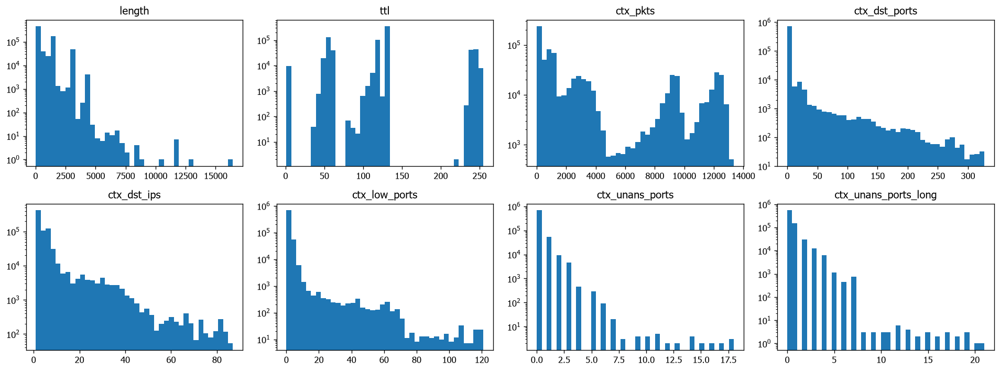
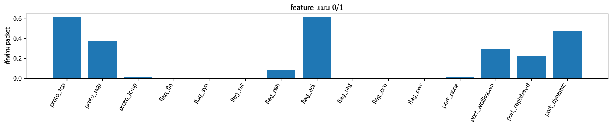
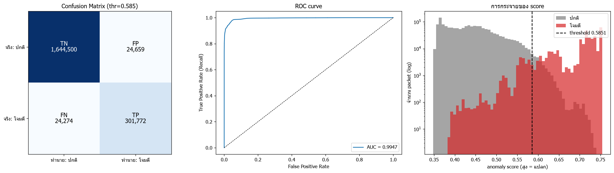

# ผลการเทรน 2026-11-18 23:40:59

## ตั้งค่า

| window_sec | n_estimators | seed | fp_quantile | max_packets/pcap | USE_SYNTHETIC | USE_CAPTURED | USE_SIM_TEST | DROP_ICMP_ECHO | THRESHOLD_MODE | MAX_TRAIN_PER_SOURCE | ICMP_MIN_FRAC | EXTRA_SYNTHETIC | FEATURE_VERSION |
|---|---|---|---|---|---|---|---|---|---|---|---|---|---|
| 5 | 1000 | 42 | 0.9980 | 2000000 | True | True | True | True | recommended | 200000 | 0.0100 | 40000 | 6 |

extra normal: `['captured_v5_active1_train.csv', 'captured_v5_night1_train.csv']` | extra test: `['captured_v5_active1_test.csv', 'captured_v5_night1_test.csv']`

time windows: `{'Friday-WorkingHours': ['2017-07-07T13:50:00-03:00', '2017-07-07T15:35:00-03:00']}`

## ข้อมูลเทรน (traffic ปกติ)

| ไฟล์ | packets ทั้งไฟล์ | ตัด ping | ใช้เทรน | TCP | UDP | ICMP | อื่นๆ |
|---|---|---|---|---|---|---|---|
| normal_packets.csv | 8000 | 0 | 8000 | 6402 | 1575 | 23 | 0 |
| normal__Monday-WorkingHours.csv | 2000000 | 6 | 250215 | 200000 | 50140 | 0 | 75 |
| captured_v5_active1_train.csv | 939703 | 0 | 226660 | 26658 | 200000 | 2 | 0 |
| captured_v5_night1_train.csv | 316278 | 0 | 218956 | 200000 | 18951 | 0 | 5 |
| synthetic เพิ่ม (seed 777) | 40000 | 0 | 40000 | 31350 | 8516 | 134 | 0 |

ICMP (ไม่ใช่ ping): 159 แถว (0.0214%) -> ทำสำเนาเพิ่ม 7,353 แถว ให้ได้ 1.00%

รวม 751,184 packets x 36 features

## การกระจายของ feature

## เทรน

ใช้เวลา 88.6s | score ข้อมูลเทรน: median=0.381 p99=0.539 max=0.671

## ชุดทดสอบ

| ชุด | packets | ติด label โจมตี | ชั่วโมง |
|---|---|---|---|
| จำลอง (ping + nmap) | 5984 | 1984 | - |
| test__Friday-WorkingHours.csv | 1624499 | 324062 | 1.7500 |
| captured_v5_active1_test.csv | 251770 | 0 | 0.4900 |
| captured_v5_night1_test.csv | 112952 | 0 | 5.3700 |

รวม 1,995,205 packets | ปกติ 1,669,159 | โจมตี 326,046

กฎใน labels.csv: 3 ข้อ

## Threshold

- recommended = 0.5851 (OK: แยก ping ออกจาก traffic ปกติได้ (วางที่ 25% ของช่องว่างจากฝั่งปกติ))
- best_f1 = 0.5998
- **ใช้ 0.5851** (โหมด recommended)

| threshold | TP | FP | TN | FN | Accuracy | Precision | Recall (TPR) | F1 | FPR |
|---|---|---|---|---|---|---|---|---|---|
| 0.5500 | 320654 | 89346 | 1579813 | 5392 | 0.9525 | 0.7821 | 0.9835 | 0.8713 | 0.0535 |
| 0.5700 | 308473 | 44980 | 1624179 | 17573 | 0.9686 | 0.8727 | 0.9461 | 0.9079 | 0.0269 |
| 0.5851 | 301772 | 24659 | 1644500 | 24274 | 0.9755 | 0.9245 | 0.9256 | 0.9250 | 0.0148 |
| 0.5900 | 300189 | 20689 | 1648470 | 25857 | 0.9767 | 0.9355 | 0.9207 | 0.9281 | 0.0124 |
| 0.5998 | 297510 | 13479 | 1655680 | 28536 | 0.9789 | 0.9567 | 0.9125 | 0.9340 | 0.0081 |
| 0.6100 | 289732 | 8279 | 1660880 | 36314 | 0.9776 | 0.9722 | 0.8886 | 0.9285 | 0.0050 |
| 0.6300 | 274325 | 2887 | 1666272 | 51721 | 0.9726 | 0.9896 | 0.8414 | 0.9095 | 0.0017 |
| 0.6500 | 252454 | 990 | 1668169 | 73592 | 0.9626 | 0.9961 | 0.7743 | 0.8713 | 0.0006 |
| 0.6700 | 243614 | 510 | 1668649 | 82432 | 0.9584 | 0.9979 | 0.7472 | 0.8545 | 0.0003 |
| 0.6900 | 238192 | 321 | 1668838 | 87854 | 0.9558 | 0.9987 | 0.7305 | 0.8438 | 0.0002 |
| 0.7100 | 204735 | 84 | 1669075 | 121311 | 0.9392 | 0.9996 | 0.6279 | 0.7713 | 0.0001 |
| 0.7300 | 114034 | 5 | 1669154 | 212012 | 0.8937 | 1.0000 | 0.3497 | 0.5182 | 0.0000 |
| 0.7500 | 47954 | 0 | 1669159 | 278092 | 0.8606 | 1.0000 | 0.1471 | 0.2564 | 0.0000 |

## แยกตามชุดทดสอบ

| ชุด | packets ปกติ | packet หลอก | อัตรา alert หลอก | packet หลอก/ชม. | packets โจมตี | จับได้ |
|---|---|---|---|---|---|---|
| จำลอง (ping + nmap) | 4000 | 6 | 0.0015 | - | 1984 | 0.8276 |
| test__Friday-WorkingHours.csv | 1300437 | 24602 | 0.0189 | 14058.6000 | 324062 | 0.9261 |
| captured_v5_active1_test.csv | 251770 | 1 | 0.0000 | 2.0000 | 0 | - |
| captured_v5_night1_test.csv | 112952 | 50 | 0.0004 | 9.3000 | 0 | - |

## ผลการวัด

### Confusion Matrix (threshold = 0.5851)
| | ทำนาย: ปกติ | ทำนาย: โจมตี |
|---|---|---|
| **จริง: ปกติ** | TN = 1,644,500 | FP = 24,659 |
| **จริง: โจมตี** | FN = 24,274 | TP = 301,772 |

- **TP** จับการโจมตีได้ถูก · **FN** การโจมตีที่หลุด
- **FP** alert หลอก (ปกติแต่ถูกมองว่าแปลก) · **TN** ปกติและตอบว่าปกติ

### Metrics
| metric | ค่า |
|---|---|
| Accuracy | 0.9755 |
| Precision | 0.9245 |
| Recall (TPR) | 0.9256 |
| F1 | 0.9250 |
| FPR | 0.0148 |
| Specificity (TNR) | 0.9852 |
| Balanced Acc | 0.9554 |
| ROC-AUC | 0.9947 |

### แยกตาม label
(แถว normal = อัตรา alert หลอก, แถวโจมตี = อัตราที่จับได้)

| label | packets | ถูกมองว่าแปลก | อัตรา |
|---|---|---|---|
| normal | 1669159 | 24659 | 0.0148 |
| PortScan | 324062 | 300130 | 0.9261 |
| nmap: nmap -sS 100 port | 100 | 96 | 0.9600 |
| nmap: nmap -sS 1000 port | 1000 | 996 | 0.9960 |
| nmap: nmap -sS ไล่ host (port 22 x100) | 100 | 41 | 0.4100 |
| nmap: nmap -sT (connect) 200 port | 200 | 196 | 0.9800 |
| nmap: nmap -sU (UDP) 100 port | 100 | 73 | 0.7300 |
| nmap: nmap -sn ไล่ host (ping sweep) | 400 | 198 | 0.4950 |
| ping: ping จากเครื่อง Linux/Mac | 8 | 4 | 0.5000 |
| ping: ping จากเครื่อง Windows | 8 | 4 | 0.5000 |
| ping: ping ตัวเอง (loopback, Windows) | 8 | 4 | 0.5000 |
| ping: ping รัว (flood เล็กน้อย) | 60 | 30 | 0.5000 |

## เกณฑ์ผ่านตาม README

| เกณฑ์ | ผล | ผ่าน |
|---|---|---|
| ping (request) ping ตัวเอง (loopback, Windows) | 100% | True |
| ping (request) ping จากเครื่อง Windows | 100% | True |
| ping (request) ping จากเครื่อง Linux/Mac | 100% | True |
| ping (request) ping รัว (flood เล็กน้อย) | 100% | True |
| nmap -sS 100 port จับได้ภายใน 40 packet แรก | packet ที่ 5 (จับได้ 96%) | True |
| nmap -sS 1000 port จับได้ภายใน 40 packet แรก | packet ที่ 5 (จับได้ 100%) | True |
| nmap -sT (connect) 200 port จับได้ภายใน 40 packet แรก | packet ที่ 5 (จับได้ 98%) | True |
| nmap -sU (UDP) 100 port จับได้ภายใน 40 packet แรก | packet ที่ 25 (จับได้ 73%) | True |
| nmap -sS ไล่ host (port 22 x100) จับได้ภายใน 40 packet แรก | packet ที่ 60 (จับได้ 41%) | False |
| nmap -sn ไล่ host (ping sweep) จับได้ภายใน 40 packet แรก | packet ที่ 1 (จับได้ 50%) | True |

**❌ ไม่ผ่านเกณฑ์ README — อย่าเอาโมเดลนี้ไปใช้ (กู้โมเดลเดิมจาก backup)**

## กราฟ Confusion Matrix / ROC / score

## บันทึกโมเดล

- model_path: `C:\Project_AI\Project-AI-IDS\system\models\iforest.joblib`
- scaler_path: `C:\Project_AI\Project-AI-IDS\system\models\scaler.joblib`
- meta_path: `C:\Project_AI\Project-AI-IDS\system\models\meta.json`
- แหล่งข้อมูลเทรน: normal_packets.csv, normal__Monday-WorkingHours.csv, captured_v5_active1_train.csv, captured_v5_night1_train.csv
