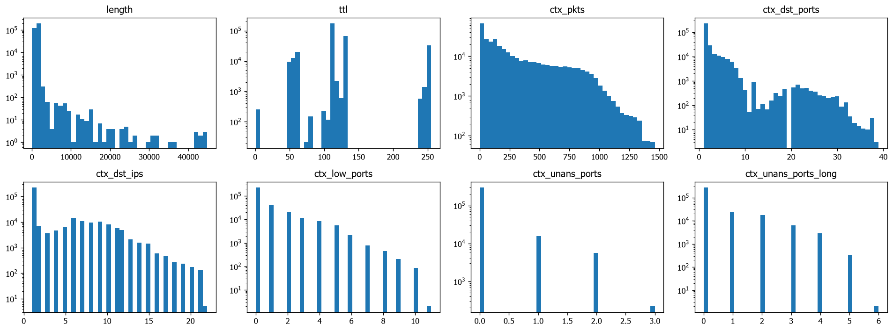
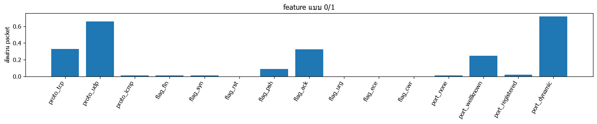
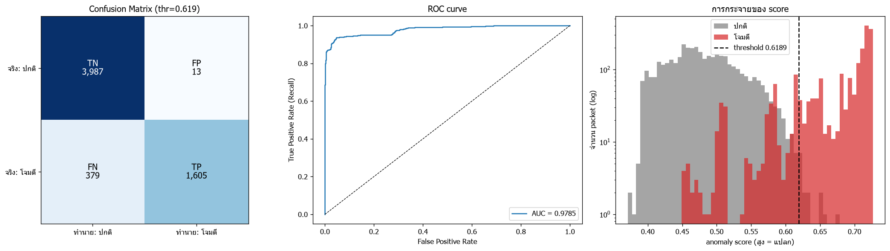

# ผลการเทรน 2026-11-19 15:34:05

## ตั้งค่า

| window_sec | n_estimators | seed | fp_quantile | max_packets/pcap | USE_SYNTHETIC | USE_CAPTURED | USE_SIM_TEST | DROP_ICMP_ECHO | THRESHOLD_MODE | MAX_TRAIN_PER_SOURCE | ICMP_MIN_FRAC | EXTRA_SYNTHETIC | FEATURE_VERSION |
|---|---|---|---|---|---|---|---|---|---|---|---|---|---|
| 5 | 1000 | 42 | 0.9980 | 2000000 | True | True | True | True | recommended | 200000 | 0.0100 | 40000 | 6 |

extra normal: `['home_discord_normal.csv', 'soak_active1_train.csv', 'soak_night1_train.csv']` | extra test: `['home_test_session2.csv', 'soak_active1_test.csv', 'soak_night1_test.csv']`

time windows: `{'Friday-WorkingHours': ['2017-07-07T13:50:00-03:00', '2017-07-07T15:35:00-03:00']}`

## ข้อมูลเทรน (traffic ปกติ)

| ไฟล์ | packets ทั้งไฟล์ | ตัด ping | ใช้เทรน | TCP | UDP | ICMP | อื่นๆ |
|---|---|---|---|---|---|---|---|
| normal_packets.csv | 8000 | 0 | 8000 | 6402 | 1575 | 23 | 0 |
| captured_full_v5.csv | 281027 | 0 | 267215 | 67204 | 200000 | 0 | 11 |
| synthetic เพิ่ม (seed 777) | 40000 | 0 | 40000 | 31350 | 8516 | 134 | 0 |

ICMP (ไม่ใช่ ping): 157 แถว (0.0498%) -> ทำสำเนาเพิ่ม 3,026 แถว ให้ได้ 1.00%

รวม 318,241 packets x 36 features

## การกระจายของ feature

## เทรน

ใช้เวลา 78.1s | score ข้อมูลเทรน: median=0.375 p99=0.571 max=0.691

## ชุดทดสอบ

| ชุด | packets | ติด label โจมตี | ชั่วโมง |
|---|---|---|---|
| จำลอง (ping + nmap) | 5984 | 1984 | - |

รวม 5,984 packets | ปกติ 4,000 | โจมตี 1,984

กฎใน labels.csv: 3 ข้อ

## Threshold

- recommended = 0.6189 (คำเตือน: ping บางตัวมี score ต่ำกว่า quantile ของ traffic ปกติ — ใช้ค่า quantile ของ traffic ปกติ (ping อาจหลุดบางตัว) ลองเพิ่มข้อมูล/ปรับ fp_quantile)
- best_f1 = 0.5837
- **ใช้ 0.6189** (โหมด recommended)

| threshold | TP | FP | TN | FN | Accuracy | Precision | Recall (TPR) | F1 | FPR |
|---|---|---|---|---|---|---|---|---|---|
| 0.5500 | 1874 | 442 | 3558 | 110 | 0.9078 | 0.8092 | 0.9446 | 0.8716 | 0.1105 |
| 0.5700 | 1860 | 206 | 3794 | 124 | 0.9449 | 0.9003 | 0.9375 | 0.9185 | 0.0515 |
| 0.5837 | 1797 | 113 | 3887 | 187 | 0.9499 | 0.9408 | 0.9057 | 0.9230 | 0.0283 |
| 0.5900 | 1733 | 86 | 3914 | 251 | 0.9437 | 0.9527 | 0.8735 | 0.9114 | 0.0215 |
| 0.6100 | 1709 | 27 | 3973 | 275 | 0.9495 | 0.9844 | 0.8614 | 0.9188 | 0.0067 |
| 0.6189 | 1605 | 13 | 3987 | 379 | 0.9345 | 0.9920 | 0.8090 | 0.8912 | 0.0032 |
| 0.6300 | 1566 | 6 | 3994 | 418 | 0.9291 | 0.9962 | 0.7893 | 0.8808 | 0.0015 |
| 0.6500 | 1424 | 2 | 3998 | 560 | 0.9061 | 0.9986 | 0.7177 | 0.8352 | 0.0005 |
| 0.6700 | 1338 | 1 | 3999 | 646 | 0.8919 | 0.9993 | 0.6744 | 0.8053 | 0.0003 |
| 0.6900 | 1206 | 0 | 4000 | 778 | 0.8700 | 1.0000 | 0.6079 | 0.7561 | 0.0000 |
| 0.7100 | 873 | 0 | 4000 | 1111 | 0.8143 | 1.0000 | 0.4400 | 0.6111 | 0.0000 |
| 0.7300 | 0 | 0 | 4000 | 1984 | 0.6684 | 0.0000 | 0.0000 | 0.0000 | 0.0000 |
| 0.7500 | 0 | 0 | 4000 | 1984 | 0.6684 | 0.0000 | 0.0000 | 0.0000 | 0.0000 |

## แยกตามชุดทดสอบ

| ชุด | packets ปกติ | packet หลอก | อัตรา alert หลอก | packet หลอก/ชม. | packets โจมตี | จับได้ |
|---|---|---|---|---|---|---|
| จำลอง (ping + nmap) | 4000 | 13 | 0.0032 | - | 1984 | 0.8090 |

## ผลการวัด

### Confusion Matrix (threshold = 0.6189)
| | ทำนาย: ปกติ | ทำนาย: โจมตี |
|---|---|---|
| **จริง: ปกติ** | TN = 3,987 | FP = 13 |
| **จริง: โจมตี** | FN = 379 | TP = 1,605 |

- **TP** จับการโจมตีได้ถูก · **FN** การโจมตีที่หลุด
- **FP** alert หลอก (ปกติแต่ถูกมองว่าแปลก) · **TN** ปกติและตอบว่าปกติ

### Metrics
| metric | ค่า |
|---|---|
| Accuracy | 0.9345 |
| Precision | 0.9920 |
| Recall (TPR) | 0.8090 |
| F1 | 0.8912 |
| FPR | 0.0032 |
| Specificity (TNR) | 0.9968 |
| Balanced Acc | 0.9029 |
| ROC-AUC | 0.9785 |

### แยกตาม label
(แถว normal = อัตรา alert หลอก, แถวโจมตี = อัตราที่จับได้)

| label | packets | ถูกมองว่าแปลก | อัตรา |
|---|---|---|---|
| normal | 4000 | 13 | 0.0032 |
| nmap: nmap -sS 100 port | 100 | 98 | 0.9800 |
| nmap: nmap -sS 1000 port | 1000 | 998 | 0.9980 |
| nmap: nmap -sS ไล่ host (port 22 x100) | 100 | 0 | 0.0000 |
| nmap: nmap -sT (connect) 200 port | 200 | 198 | 0.9900 |
| nmap: nmap -sU (UDP) 100 port | 100 | 95 | 0.9500 |
| nmap: nmap -sn ไล่ host (ping sweep) | 400 | 190 | 0.4750 |
| ping: ping จากเครื่อง Linux/Mac | 8 | 4 | 0.5000 |
| ping: ping จากเครื่อง Windows | 8 | 2 | 0.2500 |
| ping: ping ตัวเอง (loopback, Windows) | 8 | 1 | 0.1250 |
| ping: ping รัว (flood เล็กน้อย) | 60 | 19 | 0.3167 |

## เกณฑ์ผ่านตาม README

| เกณฑ์ | ผล | ผ่าน |
|---|---|---|
| ping (request) ping ตัวเอง (loopback, Windows) | 25% | False |
| ping (request) ping จากเครื่อง Windows | 50% | False |
| ping (request) ping จากเครื่อง Linux/Mac | 100% | True |
| ping (request) ping รัว (flood เล็กน้อย) | 63% | False |
| nmap -sS 100 port จับได้ภายใน 40 packet แรก | packet ที่ 3 (จับได้ 98%) | True |
| nmap -sS 1000 port จับได้ภายใน 40 packet แรก | packet ที่ 3 (จับได้ 100%) | True |
| nmap -sT (connect) 200 port จับได้ภายใน 40 packet แรก | packet ที่ 3 (จับได้ 99%) | True |
| nmap -sU (UDP) 100 port จับได้ภายใน 40 packet แรก | packet ที่ 5 (จับได้ 95%) | True |
| nmap -sS ไล่ host (port 22 x100) จับได้ภายใน 40 packet แรก | จับไม่ได้ | False |
| nmap -sn ไล่ host (ping sweep) จับได้ภายใน 40 packet แรก | packet ที่ 1 (จับได้ 48%) | True |

**❌ ไม่ผ่านเกณฑ์ README — อย่าเอาโมเดลนี้ไปใช้ (กู้โมเดลเดิมจาก backup)**

## กราฟ Confusion Matrix / ROC / score

## บันทึกโมเดล

- model_path: `C:\Project_AI\home-nids\system\models\iforest.joblib`
- scaler_path: `C:\Project_AI\home-nids\system\models\scaler.joblib`
- meta_path: `C:\Project_AI\home-nids\system\models\meta.json`
- แหล่งข้อมูลเทรน: normal_packets.csv, captured_full_v5.csv
