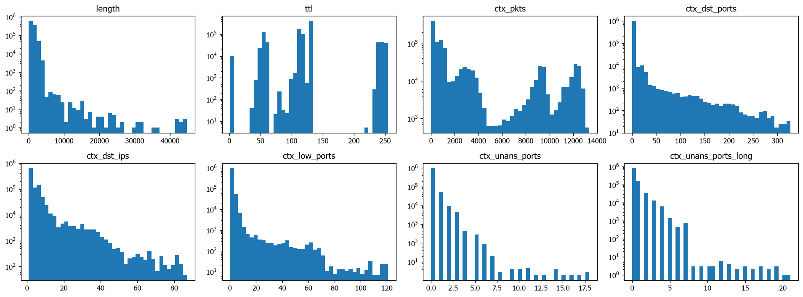
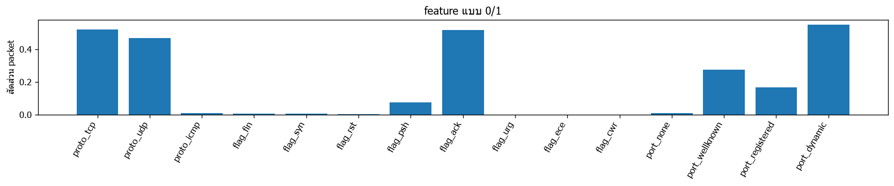
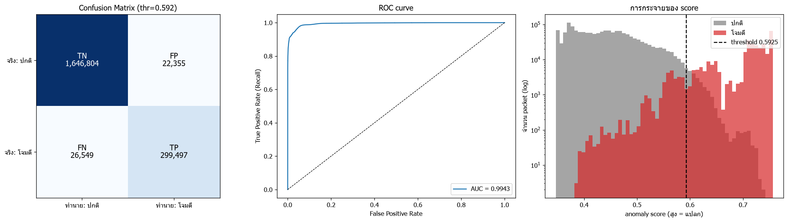

# ผลการเทรน 2026-11-19 15:38:57

## ตั้งค่า

| window_sec | n_estimators | seed | fp_quantile | max_packets/pcap | USE_SYNTHETIC | USE_CAPTURED | USE_SIM_TEST | DROP_ICMP_ECHO | THRESHOLD_MODE | MAX_TRAIN_PER_SOURCE | ICMP_MIN_FRAC | EXTRA_SYNTHETIC | FEATURE_VERSION |
|---|---|---|---|---|---|---|---|---|---|---|---|---|---|
| 5 | 1000 | 42 | 0.9980 | 2000000 | True | True | True | True | recommended | 200000 | 0.0100 | 40000 | 6 |

extra normal: `['captured_v5_active1_train.csv', 'captured_v5_night1_train.csv', 'normal__Monday-WorkingHours.csv']` | extra test: `['captured_v5_active1_test.csv', 'captured_v5_night1_test.csv', 'test__Friday-WorkingHours.csv']`

time windows: `{'Friday-WorkingHours': ['2017-07-07T13:50:00-03:00', '2017-07-07T15:35:00-03:00']}`

## ข้อมูลเทรน (traffic ปกติ)

| ไฟล์ | packets ทั้งไฟล์ | ตัด ping | ใช้เทรน | TCP | UDP | ICMP | อื่นๆ |
|---|---|---|---|---|---|---|---|
| normal_packets.csv | 8000 | 0 | 8000 | 6402 | 1575 | 23 | 0 |
| captured_full_v5.csv | 281027 | 0 | 267215 | 67204 | 200000 | 0 | 11 |
| captured_v5_active1_train.csv | 939703 | 0 | 226660 | 26658 | 200000 | 2 | 0 |
| captured_v5_night1_train.csv | 316278 | 0 | 218956 | 200000 | 18951 | 0 | 5 |
| normal__Monday-WorkingHours.csv | 2000000 | 6 | 250215 | 200000 | 50140 | 0 | 75 |
| synthetic เพิ่ม (seed 777) | 40000 | 0 | 40000 | 31350 | 8516 | 134 | 0 |

ICMP (ไม่ใช่ ping): 159 แถว (0.0157%) -> ทำสำเนาเพิ่ม 10,052 แถว ให้ได้ 1.00%

รวม 1,021,098 packets x 36 features

## การกระจายของ feature

## เทรน

ใช้เวลา 173.9s | score ข้อมูลเทรน: median=0.377 p99=0.543 max=0.671

## ชุดทดสอบ

| ชุด | packets | ติด label โจมตี | ชั่วโมง |
|---|---|---|---|
| จำลอง (ping + nmap) | 5984 | 1984 | - |
| captured_v5_active1_test.csv | 251770 | 0 | 0.4900 |
| captured_v5_night1_test.csv | 112952 | 0 | 5.3700 |
| test__Friday-WorkingHours.csv | 1624499 | 324062 | 1.7500 |

รวม 1,995,205 packets | ปกติ 1,669,159 | โจมตี 326,046

กฎใน labels.csv: 3 ข้อ

## Threshold

- recommended = 0.5925 (OK: แยก ping ออกจาก traffic ปกติได้ (วางที่ 25% ของช่องว่างจากฝั่งปกติ))
- best_f1 = 0.6040
- **ใช้ 0.5925** (โหมด recommended)

| threshold | TP | FP | TN | FN | Accuracy | Precision | Recall (TPR) | F1 | FPR |
|---|---|---|---|---|---|---|---|---|---|
| 0.5500 | 320498 | 105331 | 1563828 | 5548 | 0.9444 | 0.7526 | 0.9830 | 0.8525 | 0.0631 |
| 0.5700 | 308697 | 53963 | 1615196 | 17349 | 0.9643 | 0.8512 | 0.9468 | 0.8965 | 0.0323 |
| 0.5900 | 299974 | 24556 | 1644603 | 26072 | 0.9746 | 0.9243 | 0.9200 | 0.9222 | 0.0147 |
| 0.5925 | 299496 | 22345 | 1646814 | 26550 | 0.9755 | 0.9306 | 0.9186 | 0.9245 | 0.0134 |
| 0.6040 | 296786 | 14198 | 1654961 | 29260 | 0.9782 | 0.9543 | 0.9103 | 0.9318 | 0.0085 |
| 0.6100 | 292333 | 10686 | 1658473 | 33713 | 0.9777 | 0.9647 | 0.8966 | 0.9294 | 0.0064 |
| 0.6300 | 276813 | 3779 | 1665380 | 49233 | 0.9734 | 0.9865 | 0.8490 | 0.9126 | 0.0023 |
| 0.6500 | 253470 | 1055 | 1668104 | 72576 | 0.9631 | 0.9959 | 0.7774 | 0.8732 | 0.0006 |
| 0.6700 | 245412 | 557 | 1668602 | 80634 | 0.9593 | 0.9977 | 0.7527 | 0.8581 | 0.0003 |
| 0.6900 | 238892 | 387 | 1668772 | 87154 | 0.9561 | 0.9984 | 0.7327 | 0.8451 | 0.0002 |
| 0.7100 | 212849 | 121 | 1669038 | 113197 | 0.9432 | 0.9994 | 0.6528 | 0.7898 | 0.0001 |
| 0.7300 | 126879 | 5 | 1669154 | 199167 | 0.9002 | 1.0000 | 0.3891 | 0.5603 | 0.0000 |
| 0.7500 | 63316 | 0 | 1669159 | 262730 | 0.8683 | 1.0000 | 0.1942 | 0.3252 | 0.0000 |

## แยกตามชุดทดสอบ

| ชุด | packets ปกติ | packet หลอก | อัตรา alert หลอก | packet หลอก/ชม. | packets โจมตี | จับได้ |
|---|---|---|---|---|---|---|
| จำลอง (ping + nmap) | 4000 | 6 | 0.0015 | - | 1984 | 0.8332 |
| captured_v5_active1_test.csv | 251770 | 1 | 0.0000 | 2.0000 | 0 | - |
| captured_v5_night1_test.csv | 112952 | 53 | 0.0005 | 9.9000 | 0 | - |
| test__Friday-WorkingHours.csv | 1300437 | 22295 | 0.0171 | 12740.3000 | 324062 | 0.9191 |

## ผลการวัด

### Confusion Matrix (threshold = 0.5925)
| | ทำนาย: ปกติ | ทำนาย: โจมตี |
|---|---|---|
| **จริง: ปกติ** | TN = 1,646,804 | FP = 22,355 |
| **จริง: โจมตี** | FN = 26,549 | TP = 299,497 |

- **TP** จับการโจมตีได้ถูก · **FN** การโจมตีที่หลุด
- **FP** alert หลอก (ปกติแต่ถูกมองว่าแปลก) · **TN** ปกติและตอบว่าปกติ

### Metrics
| metric | ค่า |
|---|---|
| Accuracy | 0.9755 |
| Precision | 0.9305 |
| Recall (TPR) | 0.9186 |
| F1 | 0.9245 |
| FPR | 0.0134 |
| Specificity (TNR) | 0.9866 |
| Balanced Acc | 0.9526 |
| ROC-AUC | 0.9943 |

### แยกตาม label
(แถว normal = อัตรา alert หลอก, แถวโจมตี = อัตราที่จับได้)

| label | packets | ถูกมองว่าแปลก | อัตรา |
|---|---|---|---|
| normal | 1669159 | 22355 | 0.0134 |
| PortScan | 324062 | 297844 | 0.9191 |
| nmap: nmap -sS 100 port | 100 | 97 | 0.9700 |
| nmap: nmap -sS 1000 port | 1000 | 997 | 0.9970 |
| nmap: nmap -sS ไล่ host (port 22 x100) | 100 | 45 | 0.4500 |
| nmap: nmap -sT (connect) 200 port | 200 | 196 | 0.9800 |
| nmap: nmap -sU (UDP) 100 port | 100 | 82 | 0.8200 |
| nmap: nmap -sn ไล่ host (ping sweep) | 400 | 194 | 0.4850 |
| ping: ping จากเครื่อง Linux/Mac | 8 | 4 | 0.5000 |
| ping: ping จากเครื่อง Windows | 8 | 4 | 0.5000 |
| ping: ping ตัวเอง (loopback, Windows) | 8 | 4 | 0.5000 |
| ping: ping รัว (flood เล็กน้อย) | 60 | 30 | 0.5000 |

## เกณฑ์ผ่านตาม README

| เกณฑ์ | ผล | ผ่าน |
|---|---|---|
| ping (request) ping ตัวเอง (loopback, Windows) | 100% | True |
| ping (request) ping จากเครื่อง Windows | 100% | True |
| ping (request) ping จากเครื่อง Linux/Mac | 100% | True |
| ping (request) ping รัว (flood เล็กน้อย) | 100% | True |
| nmap -sS 100 port จับได้ภายใน 40 packet แรก | packet ที่ 4 (จับได้ 97%) | True |
| nmap -sS 1000 port จับได้ภายใน 40 packet แรก | packet ที่ 4 (จับได้ 100%) | True |
| nmap -sT (connect) 200 port จับได้ภายใน 40 packet แรก | packet ที่ 5 (จับได้ 98%) | True |
| nmap -sU (UDP) 100 port จับได้ภายใน 40 packet แรก | packet ที่ 19 (จับได้ 82%) | True |
| nmap -sS ไล่ host (port 22 x100) จับได้ภายใน 40 packet แรก | packet ที่ 56 (จับได้ 45%) | False |
| nmap -sn ไล่ host (ping sweep) จับได้ภายใน 40 packet แรก | packet ที่ 1 (จับได้ 48%) | True |

**❌ ไม่ผ่านเกณฑ์ README — อย่าเอาโมเดลนี้ไปใช้ (กู้โมเดลเดิมจาก backup)**

## กราฟ Confusion Matrix / ROC / score

## บันทึกโมเดล

- model_path: `C:\Project_AI\home-nids\system\models\iforest.joblib`
- scaler_path: `C:\Project_AI\home-nids\system\models\scaler.joblib`
- meta_path: `C:\Project_AI\home-nids\system\models\meta.json`
- แหล่งข้อมูลเทรน: normal_packets.csv, captured_full_v5.csv, captured_v5_active1_train.csv, captured_v5_night1_train.csv, normal__Monday-WorkingHours.csv
